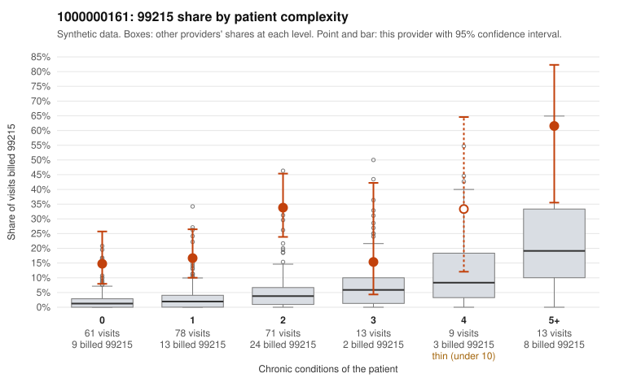

# 1000000161: Provider 1000000161's 99215 share is elevated in every complexity band, including patients with no chronic conditions, but the few documented 99215 charts all support the billed level, so the evidence is unresolved.

**Leaning (advisory):** Inconclusive

## Why

1000000161 billed 99215 on 24.1% of 245 claims against an expected 3.4% given patient complexity (risk-adjusted score 5.91; plain z-score vs peers 2.95). 37% of this provider's 99215 claims were on patients with 0 or 1 chronic conditions. Records came back for 28 claims. Of 5 documented 99215 claims, 0 (0%) were documented below the billed level, against 10% for the comparison providers. 2 of 20 notes claiming moderate-or-higher data reviewed had no lab or test line on the claim. The claims-side pattern is concerning. The excess is not limited to sicker patients: the 0-, 1- and 2-condition bands run several times the all-provider share, and sampled low-complexity 99215s are often for simple acute problems, such as URI on C0091972 and C0091987, and rash on C0092070, C0092122 and C0092165. Some patients also repeat, for example M0038800 on C0092038, C0092070 and C0092122. The documentation cuts the other way, since none of the documented 99215s fell below the billed level, but it is too thin to settle the question with only five charts. One of the supported examples, C0092113, is a zero-condition UTI visit documented as high MDM with no time recorded, which is worth a closer look for cloned or inflated notes. The data-reviewed-without-lab signal is small and only weak evidence. A reviewer should first request charts for the sampled low-complexity 99215 claims, especially the repeat-patient acute visits, and check whether their MDM narratives are specific to each encounter or templated. Examples: C0091944: billed 99215, patient aged 45 with 1 chronic condition(s) (type 2 diabetes). C0091952: billed 99215, patient aged 40 with 0 chronic condition(s).

## Evidence chart

## Cited claims

`C0091944`, `C0091952`

## Suggested next steps

- Request records for a larger sample of this provider's 99214 and 99215 claims; what came back is too thin to judge.
- Re-screen the provider once the records arrive.

---
Citations checked: 2/2 valid. Synthetic data. The leaning is advisory; the flag comes from the statistical screen, and no clinical documentation is available beyond the sampled records-review facts shown in the packet.
