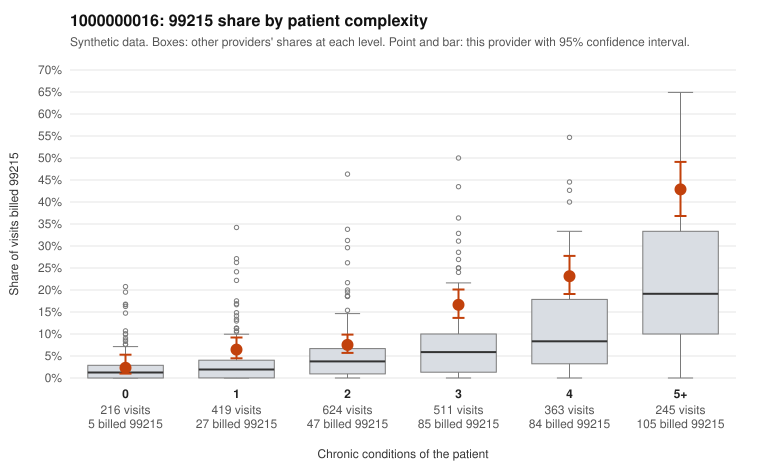

# 1000000016: Provider 1000000016 bills 99215 well above risk-adjusted expectation, with elevated rates in every complexity band, but documentation is too thin to tell upcoding from a sicker panel.

**Leaning (advisory):** Inconclusive

## Why

1000000016 billed 99215 on 14.8% of 2,378 claims against an expected 5.5% given patient complexity (risk-adjusted score 6.61; plain z-score vs peers 1.48). 9% of this provider's 99215 claims were on patients with 0 or 1 chronic conditions. Records came back for 18 claims. Of 5 documented 99215 claims, 1 (20%) were documented below the billed level, against 15% for the comparison providers. 0 of 16 notes claiming moderate-or-higher data reviewed had no lab or test line on the claim. The excess 99215 share is not explained by case mix alone: it runs above the all-provider rate in every complexity band from 1 condition upward, and the sampled low-complexity 99215 claims include routine-looking visits such as C0005324 (URI only, no chronic conditions) and C0007454 (Z09 follow-up). Against that, most of this provider's 99215s fall on patients with 3 or more conditions, only a small share land on 0–1 condition patients, and the sampled high-complexity claims (e.g., C0007389, C0006041) look like plausible high-MDM visits. The records review is the weak link: only 5 documented 99215 claims came back, and their unsupported rate is close to the comparison rate. The data-reviewed claims all had a lab or test line, so there is no sign of cloned notes. Neither side can be confirmed from this packet. A reviewer should first request charts for the sampled low-complexity 99215 claims, starting with C0005324, C0006268, C0007454 and C0007603, to see whether high MDM or qualifying time is documented, then widen the records sample before drawing any conclusion. Examples: C0005941: billed 99215; documented MDM level moderate, minutes not recorded. C0005253: billed 99215, patient aged 63 with 1 chronic condition(s) (hypertension). C0005324: billed 99215, patient aged 61 with 0 chronic condition(s).

## Evidence chart

## Cited claims

`C0005941`, `C0005253`, `C0005324`

## Suggested next steps

- Request records for a larger sample of this provider's 99214 and 99215 claims; what came back is too thin to judge.
- Re-screen the provider once the records arrive.

---
Citations checked: 3/3 valid. Synthetic data. The leaning is advisory; the flag comes from the statistical screen, and no clinical documentation is available beyond the sampled records-review facts shown in the packet.
