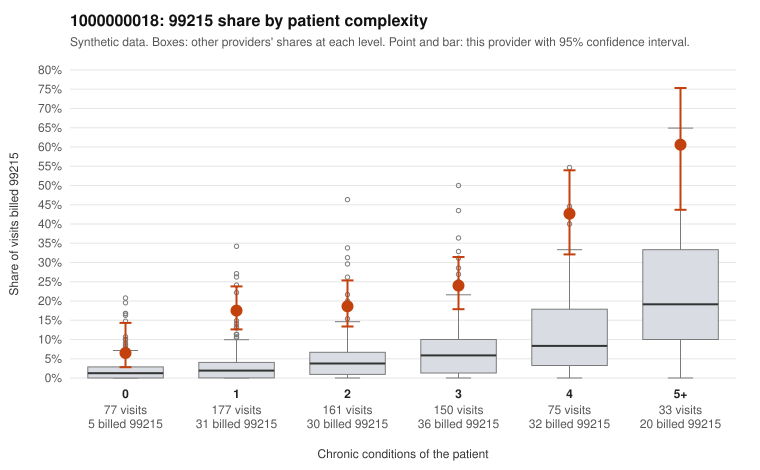

# 1000000018: Provider 1000000018 bills 99215 well above expectation at every complexity level, and the small set of returned charts supports the billed level, so the evidence points both ways and is not conclusive.

**Leaning (advisory):** Inconclusive

## Why

1000000018 billed 99215 on 22.9% of 673 claims against an expected 4.3% given patient complexity (risk-adjusted score 7.84; plain z-score vs peers 2.76). 23% of this provider's 99215 claims were on patients with 0 or 1 chronic conditions. Records came back for 24 claims. Of 7 documented 99215 claims, 0 (0%) were documented below the billed level, against 15% for the comparison providers. 2 of 13 notes claiming moderate-or-higher data reviewed had no lab or test line on the claim. The 99215 share runs well above the all-provider share in every condition band, including patients with 0 or 1 chronic conditions (for example C0008337, C0008475 and C0008934 have no listed conditions). A uniform lift across bands like this fits a provider-level coding habit better than a sicker panel, because a complex panel would mainly raise rates in the high-condition bands. Against that, none of the 7 documented 99215 claims fell below the billed level. That includes C0008573, a single-condition hypertension visit documented as high MDM with no minutes recorded, so on its face the documentation supports the billing. Seven charts, about 4% of claims overall, are too thin to settle the question. The 2 notes claiming moderate-or-higher data reviewed with no lab or test line on the claim are weak evidence, but they raise the possibility that notes were templated or inflated to match the billed level. The reviewer should first request charts for the low-complexity 99215 sample (starting with the zero-condition and Z09 follow-up visits such as C0008883 and C0008916) and check whether the high-MDM notes, including C0008573, describe problem-specific, contemporaneous work rather than cloned text. Examples: C0008624: billed 99214; documented MDM level low, minutes not recorded. C0008287: billed 99215, patient aged 41 with 1 chronic condition(s) (type 2 diabetes). C0008337: billed 99215, patient aged 37 with 0 chronic condition(s).

## Evidence chart

## Cited claims

`C0008624`, `C0008287`, `C0008337`

## Suggested next steps

- Request records for a larger sample of this provider's 99214 and 99215 claims; what came back is too thin to judge.
- Re-screen the provider once the records arrive.

---
Citations checked: 3/3 valid. Synthetic data. The leaning is advisory; the flag comes from the statistical screen, and no clinical documentation is available beyond the sampled records-review facts shown in the packet.
