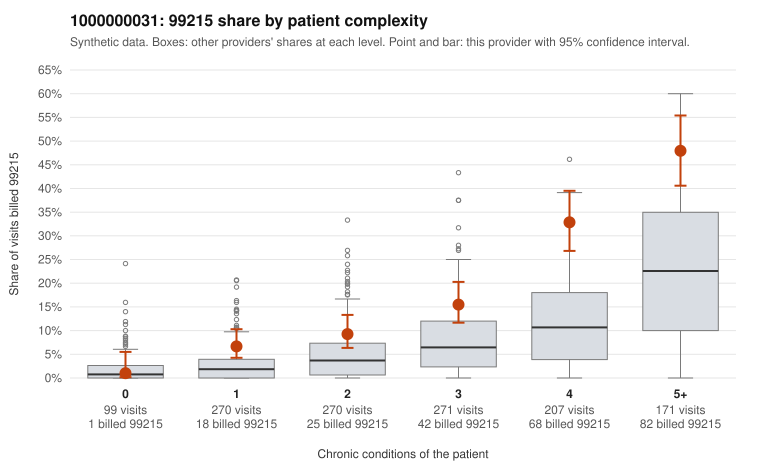

# 1000000031: Elevated 99215 use runs above peers in every complexity band with the steepest excess in sicker patients, but documentation is too thin to say whether the high-level visits are supported.

**Leaning (advisory):** Inconclusive

## Why

1000000031 billed 99215 on 18.3% of 1,288 claims against an expected 6.7% given patient complexity (risk-adjusted score 7.04; plain z-score vs peers 2.52). 8% of this provider's 99215 claims were on patients with 0 or 1 chronic conditions. Records came back for 22 claims. Of 1 documented 99215 claims, 0 (0%) were documented below the billed level, against 0% for the comparison providers. 2 of 13 notes claiming moderate-or-higher data reviewed had no lab or test line on the claim. The excess 99215 billing is concentrated where it would be most expected, among patients with 4 or more conditions (e.g., C0010436, C0011388), and only a small share falls on low-complexity patients, which leans toward a sicker panel. Even so, the provider bills 99215 at roughly double the all-provider rate within each band from 1 to 5+ conditions, so complexity alone does not fully explain the pattern, and the sampled low-complexity 99215s (e.g., C0010444, C0011100, C0011574 with no chronic conditions) deserve scrutiny. Records came back for only a tiny fraction of claims with a single documented 99215 (C0011079, supported at high MDM), so the absence of unsupported claims says little either way, and the few notes claiming moderate-plus data reviewed without a lab line are weak signals, not proof. A reviewer should first request charts targeted at the low-complexity 99215 claims and a larger sample of 4+ condition 99215s to test whether documented MDM supports the billed level, checking for cloned or templated notes. Examples: C0010444: billed 99215, patient aged 49 with 1 chronic condition(s) (hypertension). C0010560: billed 99215, patient aged 44 with 1 chronic condition(s) (hypertension).

## Evidence chart

## Cited claims

`C0010444`, `C0010560`

## Suggested next steps

- Request records for a larger sample of this provider's 99214 and 99215 claims; what came back is too thin to judge.
- Re-screen the provider once the records arrive.

---
Citations checked: 2/2 valid. Synthetic data. The leaning is advisory; the flag comes from the statistical screen, and no clinical documentation is available beyond the sampled records-review facts shown in the packet.
