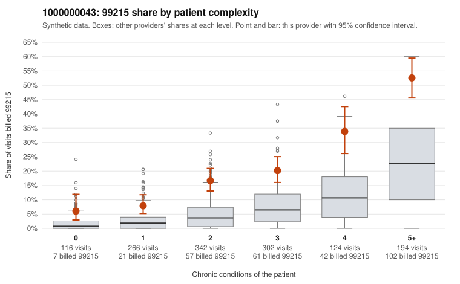

# 1000000043: Provider 1000000043 bills 99215 well above risk-adjusted expectation, but the few charts returned support the billed levels, so the pattern cannot yet be attributed to upcoding or to a sicker panel.

**Leaning (advisory):** Inconclusive

## Why

1000000043 billed 99215 on 21.6% of 1,344 claims against an expected 6.5% given patient complexity (risk-adjusted score 9.43; plain z-score vs peers 3.15). 10% of this provider's 99215 claims were on patients with 0 or 1 chronic conditions. Records came back for 15 claims. Of 5 documented 99215 claims, 0 (0%) were documented below the billed level, against 0% for the comparison providers. 0 of 10 notes claiming moderate-or-higher data reviewed had no lab or test line on the claim. Most of this provider's 99215s fall on multi-morbid patients, as in sampled claims C0015108 and C0016405, which fits a complex panel. However, the 99215 share runs roughly two to three times the all-provider rate in every complexity band, including patients with zero conditions, and 99214 dominates the overall mix. That points to an upward shift across the board rather than only appropriate coding of sick patients. The sampled low-complexity 99215s include several single-problem visits, such as zero-condition urinary tract infection visits (C0015015, C0015687, C0015838) and isolated back pain (C0015892). These are the claims where a top-level code is hardest to justify. The documentation does not help much yet: the 5 documented 99215s all support high MDM (for example C0015692 and C0016065), and nothing suggests cloned data-review notes, but records came back for only about 1% of claims, which is too thin to judge. A reviewer should first request charts for the low-complexity 99215 claims listed in the packet, then check whether 99214 visits on low-complexity patients are similarly supported, before drawing any conclusion. Examples: C0015013: billed 99215, patient aged 66 with 1 chronic condition(s) (osteoarthritis). C0015015: billed 99215, patient aged 38 with 0 chronic condition(s).

## Evidence chart

## Cited claims

`C0015013`, `C0015015`

## Suggested next steps

- Request records for a larger sample of this provider's 99214 and 99215 claims; what came back is too thin to judge.
- Re-screen the provider once the records arrive.

---
Citations checked: 2/2 valid. Synthetic data. The leaning is advisory; the flag comes from the statistical screen, and no clinical documentation is available beyond the sampled records-review facts shown in the packet.
