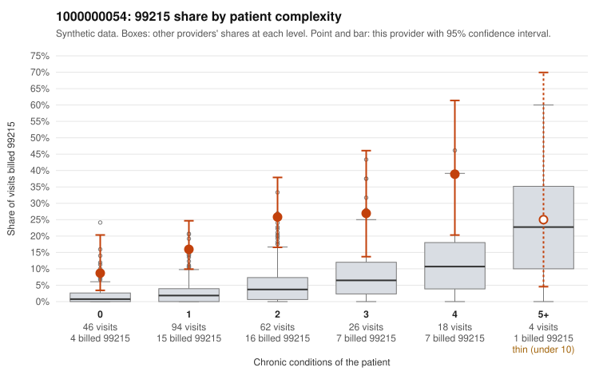

# 1000000054: Elevated 99215 billing at every complexity tier, including many low-complexity visits, but documentation is too thin to separate upcoding from a sicker panel.

**Leaning (advisory):** Inconclusive

## Why

1000000054 billed 99215 on 20.0% of 250 claims against an expected 3.4% given patient complexity (risk-adjusted score 5.91; plain z-score vs peers 2.84). 38% of this provider's 99215 claims were on patients with 0 or 1 chronic conditions. Records came back for 16 claims. Of 3 documented 99215 claims, 0 (0%) were documented below the billed level, against 0% for the comparison providers. 3 of 11 notes claiming moderate-or-higher data reviewed had no lab or test line on the claim. The 99215 share runs well above the all-provider rate in nearly every complexity tier (except 5+), and over a third of 99215s fall on patients with 0 or 1 chronic conditions. Several sampled examples are single routine diagnoses such as I10, E11.9 or E78.5 (e.g., C0024436, C0024665, C0024669), which is the pattern most consistent with upcoding. Against that, the few charts returned all supported the billed level, including high-MDM 99215s on a low-complexity claim (C0024646) and a high-complexity claim (C0024533). That is too small a documented sample to lean either way, and the 3 moderate-plus data-reviewed notes with no lab or test line are weak evidence of possible templated documentation, not proof. A reviewer should first request charts for the sampled low-complexity 99215 claims (starting with C0024436, C0024604, C0024638 and C0024665), check whether MDM and time are genuinely supported, and look for cloned note language across visits. Examples: C0024403: billed 99215, patient aged 55 with 1 chronic condition(s) (asthma). C0024416: billed 99215, patient aged 67 with 1 chronic condition(s) (atrial fibrillation).

## Evidence chart

## Cited claims

`C0024403`, `C0024416`

## Suggested next steps

- Request records for a larger sample of this provider's 99214 and 99215 claims; what came back is too thin to judge.
- Re-screen the provider once the records arrive.

---
Citations checked: 2/2 valid. Synthetic data. The leaning is advisory; the flag comes from the statistical screen, and no clinical documentation is available beyond the sampled records-review facts shown in the packet.
