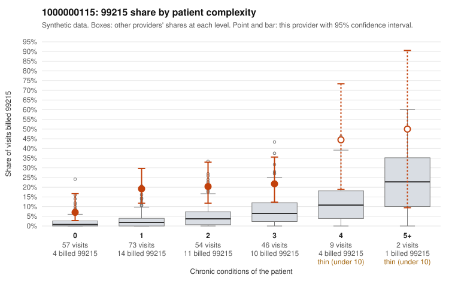

# 1000000115: Provider 1000000115 bills 99215 well above risk-adjusted expectation, with much of it on low-complexity patients, but records came back for too few 99215 claims to confirm or rule out upcoding.

**Leaning (advisory):** Inconclusive

## Why

1000000115 billed 99215 on 18.3% of 241 claims against an expected 3.3% given patient complexity (risk-adjusted score 5.31; plain z-score vs peers 2.51). 41% of this provider's 99215 claims were on patients with 0 or 1 chronic conditions. Records came back for 17 claims. Of 2 documented 99215 claims, 0 (0%) were documented below the billed level, against 0% for the comparison providers. 3 of 12 notes claiming moderate-or-higher data reviewed had no lab or test line on the claim. The claims pattern leans toward concern: the 99215 share runs several times the all-provider rate in every complexity band, including patients with 0 or 1 chronic conditions. The sampled low-complexity 99215 claims carry routine diagnoses such as uncomplicated hypertension, obesity, rash and low back pain (e.g., C0048846, C0048895, C0048912), and some patients repeat at 99215 (M0020634, M0020571). The documentation does not support that concern, but it is too thin to judge: only 2 documented 99215 claims exist, and both were supported, including C0049020, a single-condition depression visit documented as high MDM. The 3 notes claiming moderate-plus data review with no lab or test line on the claim are weak evidence of possibly templated notes, not proof. A reviewer should first request charts for the sampled low-complexity 99215 claims, prioritizing repeat patients M0020634 and M0020571, and check whether the MDM and time documentation reflects what actually happened at the visit. Examples: C0049018: billed 99214; documented MDM level low, minutes not recorded. C0048821: billed 99215, patient aged 55 with 1 chronic condition(s) (hypertension). C0048841: billed 99215, patient aged 54 with 1 chronic condition(s) (obesity).

## Evidence chart

## Cited claims

`C0049018`, `C0048821`, `C0048841`

## Suggested next steps

- Request records for a larger sample of this provider's 99214 and 99215 claims; what came back is too thin to judge.
- Re-screen the provider once the records arrive.

---
Citations checked: 3/3 valid. Synthetic data. The leaning is advisory; the flag comes from the statistical screen, and no clinical documentation is available beyond the sampled records-review facts shown in the packet.
