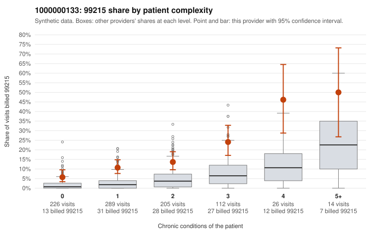

# 1000000133: Provider 1000000133 bills 99215 well above expectation in every complexity tier, including many low-complexity visits, but the few returned charts support the billed levels and are too thin to settle the question.

**Leaning (advisory):** Inconclusive

## Why

1000000133 billed 99215 on 13.5% of 872 claims against an expected 3.2% given patient complexity (risk-adjusted score 7.20; plain z-score vs peers 1.60). 37% of this provider's 99215 claims were on patients with 0 or 1 chronic conditions. Records came back for 19 claims. Of 3 documented 99215 claims, 0 (0%) were documented below the billed level, against 0% for the comparison providers. 0 of 14 notes claiming moderate-or-higher data reviewed had no lab or test line on the claim. The billing pattern leans toward upcoding. The 99215 share runs roughly two to four times the all-provider rate in every condition-count tier, not just among sicker patients, and the mix is dominated by 99214. More than a third of the 99215s fall on patients with 0–1 chronic conditions, with diagnoses such as upper respiratory infection (C0059377, C0059904), UTI (C0059547, C0059715), low back pain (C0059483) or a follow-up code alone (C0060154), which would not usually support high-complexity decision making. Against that, the records review gives no confirmation: only 3 documented 99215s came back, all documented at high MDM. The one below-billed note (C0059564) is a 99214, and the data-reviewed notes all match lab or test lines on the claim. That is too little documentation to judge either way. The supported claim C0059583 is a 42-year-old with no chronic conditions billed for abdominal pain. A reviewer should check whether its high-MDM note reflects a genuine acute workup or a templated or cloned note. The first next step is a targeted records request for the low-complexity 99215 claims listed in the packet. Examples: C0059564: billed 99214; documented MDM level low, minutes not recorded. C0059377: billed 99215, patient aged 48 with 0 chronic condition(s). C0059394: billed 99215, patient aged 58 with 1 chronic condition(s) (hyperlipidemia).

## Evidence chart

## Cited claims

`C0059564`, `C0059377`, `C0059394`

## Suggested next steps

- Request records for a larger sample of this provider's 99214 and 99215 claims; what came back is too thin to judge.
- Re-screen the provider once the records arrive.

---
Citations checked: 3/3 valid. Synthetic data. The leaning is advisory; the flag comes from the statistical screen, and no clinical documentation is available beyond the sampled records-review facts shown in the packet.
