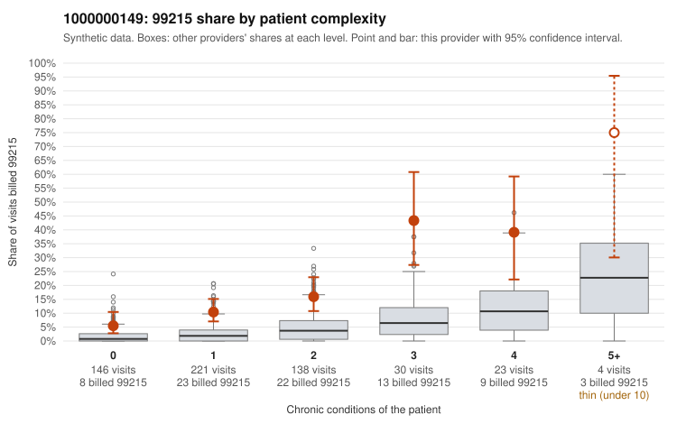

# 1000000149: Elevated 99215 use across every complexity tier, including a sizable share on patients with 0-1 chronic conditions, is consistent with upcoding, but the records sample is too thin to confirm it.

**Leaning (advisory):** Inconclusive

## Why

1000000149 billed 99215 on 13.9% of 562 claims against an expected 2.8% given patient complexity (risk-adjusted score 6.52; plain z-score vs peers 1.67). 40% of this provider's 99215 claims were on patients with 0 or 1 chronic conditions. Records came back for 15 claims. Of 3 documented 99215 claims, 0 (0%) were documented below the billed level, against 0% for the comparison providers. 1 of 9 notes claiming moderate-or-higher data reviewed had no lab or test line on the claim. The billing pattern leans toward concern. This provider's 99215 share exceeds the all-provider share in every complexity band, not just among complex patients. About two-fifths of the 99215s fall on patients with 0-1 conditions, and the sampled low-complexity claims carry routine diagnoses such as J06.9, N39.0, Z09 and I10 (e.g., C0066359, C0066822, C0066858). In contrast, the high-complexity sampled 99215s (e.g., C0066357, C0066598) look plausible. Documentation does not resolve the question. Only three 99215 charts came back, and all three supported the billed level (C0066398, C0066654, C0066677). The single below-billed note was a 99214 (C0066568), and only 1 of 9 moderate-plus data-reviewed notes lacked a lab line. These counts are too small to read as either confirmation or exoneration. A reviewer should first request charts for the sampled low-complexity 99215 claims, especially the zero-condition visits. The reviewer should check whether MDM or time supports level 5 and watch for templated or cloned notes. Examples: C0066568: billed 99214; documented MDM level low, minutes not recorded. C0066327: billed 99215, patient aged 66 with 1 chronic condition(s) (osteoarthritis). C0066359: billed 99215, patient aged 47 with 0 chronic condition(s).

## Evidence chart

## Cited claims

`C0066568`, `C0066327`, `C0066359`

## Suggested next steps

- Request records for a larger sample of this provider's 99214 and 99215 claims; what came back is too thin to judge.
- Re-screen the provider once the records arrive.

---
Citations checked: 3/3 valid. Synthetic data. The leaning is advisory; the flag comes from the statistical screen, and no clinical documentation is available beyond the sampled records-review facts shown in the packet.
