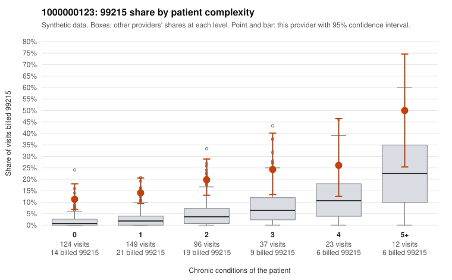

# Payment Integrity dossier: 1000000123

> Draft for human review. Statistical and records-sample evidence only; not a finding. Compliance or legal review is needed before any provider contact, notice or recoupment.

## Provider overview

| | |
|---|---|
| Specialty / state | Family Practice, GA (synthetic) |
| Claims / patients | 441 / 213 |
| Billed mix (99211 to 99215) | 1 / 2 / 102 / 261 / 75 |
| 99215 share | 17.0% |
| Expected 99215 share given patient complexity | 3.3% |
| Screen scores | z vs peers 2.27; risk-adjusted 6.65; flagged by suspicion>=5 |

## Case summary (advisory)

**High 99215 share concentrated on low-complexity patients is consistent with upcoding, but documentation is too thin to confirm or refute it.**

Leaning: pattern consistent with upcoding. Citations checked: 5/5 valid.

1000000123 billed 99215 on 17.0% of 441 claims against an expected 3.3% given patient complexity (risk-adjusted score 6.65; plain z-score vs peers 2.27). 47% of this provider's 99215 claims were on patients with 0 or 1 chronic conditions. Records came back for 18 claims. Of 2 documented 99215 claims, 0 (0%) were documented below the billed level, against 0% for the comparison providers. 2 of 12 notes claiming moderate-or-higher data reviewed had no lab or test line on the claim. The billing pattern, not the records, drives this leaning. 99215 rates run well above all-provider rates in every complexity band, including patients with zero or one chronic condition. Nearly half of the 99215s fall in that low-complexity group, and the sampled low-complexity 99215s carry simple diagnoses such as low back pain (C0054853, C0054967), rash (C0055022, C0055048) and follow-up-only codes (C0054987, C0055093, C0055197), which would rarely support high-complexity decision making. The records review cannot settle the question: only two 99215 claims were documented, and both supported the billed level (C0055106, C0055166). The 99214 below-billed rate is elevated relative to peers (C0054846, C0055017 documented as low MDM), and two notes claiming moderate-or-higher data review had no lab or test line, which is weak evidence of inflated notes. A reviewer should first request charts for the sampled low-complexity 99215 claims listed above, then compare the documented MDM and time against the billed level. Examples: C0054846: billed 99214; documented MDM level low, 29 minutes. C0055017: billed 99214; documented MDM level low, minutes not recorded. C0054853: billed 99215, patient aged 44 with 0 chronic condition(s). C0054858: billed 99215, patient aged 43 with 1 chronic condition(s) (obesity). C0054888: billed 99215, patient aged 47 with 1 chronic condition(s) (osteoarthritis).

## Evidence chart

## Records-review sample so far

Documentation is on file for 18 claims (4% of this provider's claims).

| Billed | Documented | Documentation below billed level | Rate | All-provider rate |
|---|---|---|---|---|
| 99213 | 4 | 0 | 0.0% | 0.7% |
| 99214 | 12 | 2 | 16.7% | 3.7% |
| 99215 | 2 | 0 | 0.0% | 0.0% |

## Recommended next steps for Payment Integrity

1. Request records for the sampled claims in `record_request_list.csv` (36 claims across 99215).
2. Review the records against E/M documentation rules and record the supported level for each claim.
3. Run the overpayment estimator on the reviewed sample (`sampling_plan.md` explains how).
4. Notice, appeal rights, recoupment, education or corrective action, and any referral are decisions for the PI team, compliance and counsel. Nothing here drafts those.

Suggested follow-ups from the case summary:

- Request the full records for the cited claims and have a certified coder re-score each against current E/M documentation rules (medical decision making or total time).
- If the re-scoring confirms the pattern, use the sampling plan in the recovery packet to review a statistical sample of this provider's 99215 claims.
- Check whether notes for the cited claims look copied forward, and whether documented minutes repeat from visit to visit.

## Limits

- Synthetic data; no real claims or providers.
- The leaning is advisory. The flag comes from the statistical screen; the summary explains it.
- The records-review sample is partial and was simulated for this project.
- Allowed amounts are GA Family Practice averages from a public CMS file, not this provider's actual payments.
