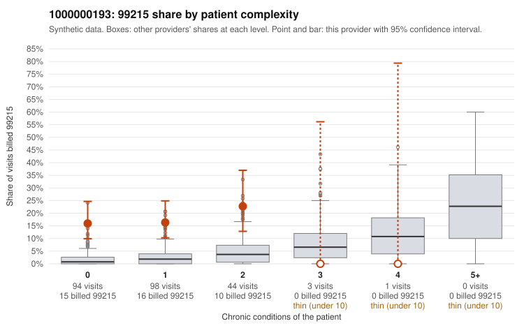

# Payment Integrity dossier: 1000000193

> Draft for human review. Statistical and records-sample evidence only; not a finding. Compliance or legal review is needed before any provider contact, notice or recoupment.

## Provider overview

| | |
|---|---|
| Specialty / state | Family Practice, GA (synthetic) |
| Claims / patients | 240 / 130 |
| Billed mix (99211 to 99215) | 0 / 0 / 52 / 147 / 41 |
| 99215 share | 17.1% |
| Expected 99215 share given patient complexity | 2.1% |
| Screen scores | z vs peers 2.28; risk-adjusted 6.64; flagged by suspicion>=5 |

## Case summary (advisory)

**Provider 1000000193's 99215 claims sit almost entirely on low-complexity patients with routine diagnoses, a pattern consistent with upcoding, though the chart evidence is too thin to confirm it.**

Leaning: pattern consistent with upcoding. Citations checked: 5/5 valid.

1000000193 billed 99215 on 17.1% of 240 claims against an expected 2.1% given patient complexity (risk-adjusted score 6.64; plain z-score vs peers 2.28). 76% of this provider's 99215 claims were on patients with 0 or 1 chronic conditions. Records came back for 18 claims. Of 4 documented 99215 claims, 2 (50%) were documented below the billed level, against 0% for the comparison providers. 2 of 15 notes claiming moderate-or-higher data reviewed had no lab or test line on the claim. The complexity breakdown is the strongest signal. The elevated 99215 share holds steady across patients with 0, 1 and 2 conditions, while the few 3–4 condition patients received no 99215s. The sampled low-complexity 99215s carry routine diagnoses such as URI, UTI, rash, low back pain and follow-up visits (e.g., C0084842, C0084744, C0084761, C0084771), which is the reverse of what a genuinely sicker panel would show. The documentation is too thin to judge: only 4 documented 99215s came back. Half of them fell below the billed level (C0084788, C0084914), but the rule check treats that count as too small to rely on. The two 'supported' 99215s should be read cautiously, because C0084812 is a back-pain visit on a patient with no chronic conditions that was documented as high MDM at 45 minutes. That could be a genuinely complex visit, or it could be inflated or cloned documentation. The 2 data-reviewed notes without a lab or test line are weak supporting evidence only. A reviewer should first request and read the full charts for the sampled low-complexity 99215s, starting with the acute or minor-diagnosis visits, and compare note text across patients for templated content. Examples: C0084788: billed 99215, patient aged 79 with 1 chronic condition(s) (hyperlipidemia); documented MDM level moderate, minutes not recorded. C0084914: billed 99215; documented MDM level moderate, 33 minutes. C0084738: billed 99215, patient aged 51 with 1 chronic condition(s) (hypertension). C0084744: billed 99215, patient aged 31 with 0 chronic condition(s). C0084749: billed 99215, patient aged 63 with 0 chronic condition(s).

## Evidence chart

## Records-review sample so far

Documentation is on file for 18 claims (8% of this provider's claims).

| Billed | Documented | Documentation below billed level | Rate | All-provider rate |
|---|---|---|---|---|
| 99213 | 3 | 0 | 0.0% | 0.7% |
| 99214 | 11 | 0 | 0.0% | 3.7% |
| 99215 | 4 | 2 | 50.0% | 0.0% |

## Recommended next steps for Payment Integrity

1. Request records for the sampled claims in `record_request_list.csv` (26 claims across 99215).
2. Review the records against E/M documentation rules and record the supported level for each claim.
3. Run the overpayment estimator on the reviewed sample (`sampling_plan.md` explains how).
4. Notice, appeal rights, recoupment, education or corrective action, and any referral are decisions for the PI team, compliance and counsel. Nothing here drafts those.

Suggested follow-ups from the case summary:

- Request the full records for the cited claims and have a certified coder re-score each against current E/M documentation rules (medical decision making or total time).
- If the re-scoring confirms the pattern, use the sampling plan in the recovery packet to review a statistical sample of this provider's 99215 claims.
- Check whether notes for the cited claims look copied forward, and whether documented minutes repeat from visit to visit.

## Limits

- Synthetic data; no real claims or providers.
- The leaning is advisory. The flag comes from the statistical screen; the summary explains it.
- The records-review sample is partial and was simulated for this project.
- Allowed amounts are GA Family Practice averages from a public CMS file, not this provider's actual payments.
