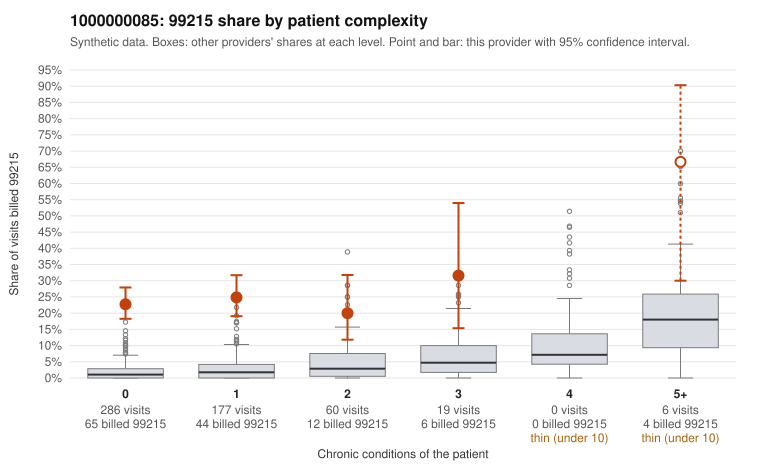

# 1000000085: 1000000085: 6 of 7 documented 99215 claims (86%) are documented below the billed level

**Leaning (advisory):** Pattern consistent with upcoding

## Why

1000000085 billed 99215 on 23.9% of 548 claims against an expected 1.9% given patient complexity (risk-adjusted score 13.99; plain z-score vs peers 3.44). 83% of this provider's 99215 claims were on patients with 0 or 1 chronic conditions. Records came back for 30 claims. Of 7 documented 99215 claims, 6 (86%) were documented below the billed level, against 14% for the comparison providers. 2 of 17 notes claiming moderate-or-higher data reviewed had no lab or test line on the claim. This pattern is consistent with upcoding. It is a reason to review the records, not a finding. Examples: C0043121: billed 99215; documented MDM level moderate, 39 minutes. C0043243: billed 99215; documented MDM level moderate, minutes not recorded. C0043547: billed 99215; documented MDM level moderate, 35 minutes. C0043035: billed 99215, patient aged 25 with 0 chronic condition(s). C0043037: billed 99215, patient aged 57 with 0 chronic condition(s). C0043051: billed 99215, patient aged 64 with 1 chronic condition(s) (hypertension).

## Evidence chart

## Cited claims

`C0043121`, `C0043243`, `C0043547`, `C0043035`, `C0043037`, `C0043051`

## Suggested next steps

- Request the full records for the cited claims and have a certified coder re-score each against current E/M documentation rules (medical decision making or total time).
- If the re-scoring confirms the pattern, use the sampling plan in the recovery packet to review a statistical sample of this provider's 99215 claims.
- Check whether notes for the cited claims look copied forward, and whether documented minutes repeat from visit to visit.

---
Citations checked: 6/6 valid. Synthetic data. The leaning is advisory; the flag comes from the statistical screen, and no clinical documentation is available beyond the sampled records-review facts shown in the packet.
