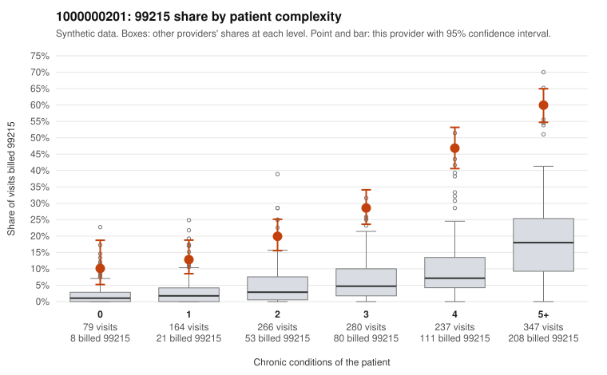

# 1000000201: Provider 1000000201 bills 99215 far above expectation in every complexity tier, but the few charts returned support the billed level, so the pattern cannot yet be distinguished from a genuinely complex panel.

**Leaning (advisory):** Inconclusive

## Why

1000000201 billed 99215 on 35.0% of 1,373 claims against an expected 6.3% given patient complexity (risk-adjusted score 16.53; plain z-score vs peers 5.45). 6% of this provider's 99215 claims were on patients with 0 or 1 chronic conditions. Records came back for 24 claims. Of 4 documented 99215 claims, 0 (0%) were documented below the billed level, against 14% for the comparison providers. 1 of 20 notes claiming moderate-or-higher data reviewed had no lab or test line on the claim. The panel does skew complex, and most 99215s fall on multi-condition patients, such as sampled claim C0104160, whose chart documented high MDM. However, the 99215 share runs well above the all-provider rate in every condition stratum, including patients with zero conditions, so panel acuity alone does not appear to explain the excess. Sampled low-complexity 99215s are the main concern: C0103880 and C0103939 are billed on patients with no chronic conditions and only a Z09 follow-up code, and C0103348 carries only unspecified abdominal pain (R10.9). Against this, the four documented 99215s were all supported and cloned-note signals were minimal, but records came back for a very small share of claims, so the documentation is too thin to confirm or rule out upcoding. A reviewer should first request charts for the low-complexity 99215s, starting with the Z09-only and symptom-only visits listed, and then a larger random sample of 99215s from mid-complexity patients (2 to 3 conditions), where the excess over peers is substantial. Examples: C0103599: billed 99214; documented MDM level low, minutes not recorded. C0103322: billed 99215, patient aged 69 with 1 chronic condition(s) (atrial fibrillation). C0103348: billed 99215, patient aged 48 with 0 chronic condition(s).

## Evidence chart

## Cited claims

`C0103599`, `C0103322`, `C0103348`

## Suggested next steps

- Request records for a larger sample of this provider's 99214 and 99215 claims; what came back is too thin to judge.
- Re-screen the provider once the records arrive.

---
Citations checked: 3/3 valid. Synthetic data. The leaning is advisory; the flag comes from the statistical screen, and no clinical documentation is available beyond the sampled records-review facts shown in the packet.
