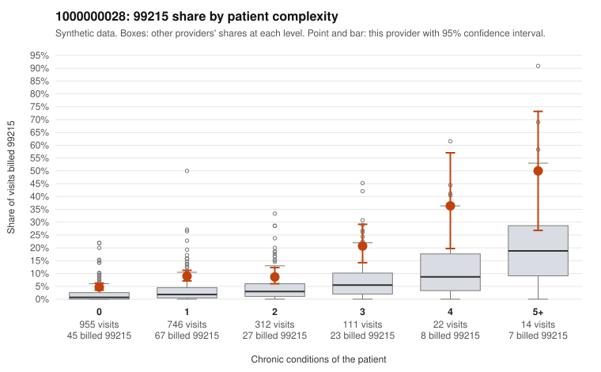

# 1000000028: Provider 1000000028 bills 99215 well above risk-adjusted expectation, with most of those visits on low-complexity patients, but documentation is too thin to confirm or refute upcoding.

**Leaning (advisory):** Inconclusive

## Why

1000000028 billed 99215 on 8.2% of 2,160 claims against an expected 2.1% given patient complexity (risk-adjusted score 9.26; plain z-score vs peers 0.65). 63% of this provider's 99215 claims were on patients with 0 or 1 chronic conditions. Records came back for 30 claims. Of 2 documented 99215 claims, 0 (0%) were documented below the billed level, against 0% for the comparison providers. 1 of 18 notes claiming moderate-or-higher data reviewed had no lab or test line on the claim. The claims pattern leans toward concern. The 99215 share runs above the all-provider rate in every complexity band, and most 99215s fall on patients with 0 or 1 chronic conditions. Sampled examples such as C0013601 and C0014978 (Z09 follow-up, no conditions) and C0013984 (R21 rash) carry diagnoses that rarely support high-complexity decision-making, whereas sampled high-complexity 99215s like C0014117 and C0015216 look plausible. The documentation cannot yet confirm this: only 2 documented 99215 claims came back, both supported (C0013640, C0014110), and there is one below-billed 99214 (C0015409) and a single moderate-plus data-reviewed note without a lab line, which is too little to read as cloning or inflation. The modest plain peer z-score next to the high risk-adjusted score also suggests some of the signal depends on the risk model, so the leaning stays inconclusive rather than upcoding. A reviewer should first request charts specifically for low-complexity 99215 claims, starting with the sampled Z09, R21 and M54.50 visits. They should check whether documented MDM or time (40+ minutes) supports level 5 on those encounters. Examples: C0015409: billed 99214; documented MDM level low, minutes not recorded. C0013601: billed 99215, patient aged 55 with 0 chronic condition(s). C0013813: billed 99215, patient aged 41 with 1 chronic condition(s) (hyperlipidemia).

## Evidence chart

## Cited claims

`C0015409`, `C0013601`, `C0013813`

## Suggested next steps

- Request records for a larger sample of this provider's 99214 and 99215 claims; what came back is too thin to judge.
- Re-screen the provider once the records arrive.

---
Citations checked: 3/3 valid. Synthetic data. The leaning is advisory; the flag comes from the statistical screen, and no clinical documentation is available beyond the sampled records-review facts shown in the packet.
