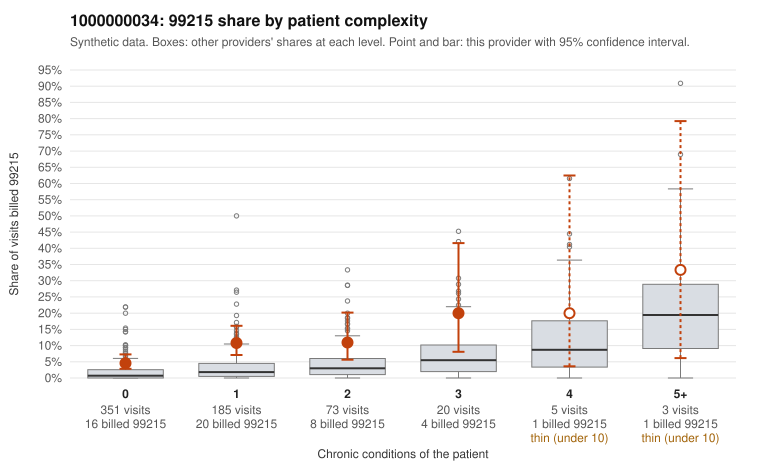

# 1000000034: Provider 1000000034 bills 99215 at about four times the complexity-adjusted expectation, mostly on patients with 0-1 chronic conditions, but documentation is too thin to confirm or refute upcoding.

**Leaning (advisory):** Inconclusive

## Why

1000000034 billed 99215 on 7.8% of 637 claims against an expected 1.9% given patient complexity (risk-adjusted score 5.27; plain z-score vs peers 0.59). 72% of this provider's 99215 claims were on patients with 0 or 1 chronic conditions. Records came back for 30 claims. Of 3 documented 99215 claims, 0 (0%) were documented below the billed level, against 0% for the comparison providers. 4 of 26 notes claiming moderate-or-higher data reviewed had no lab or test line on the claim. The billing pattern raises concern because most 99215 claims fall on low-complexity patients. The sampled low-complexity 99215s include visits coded only with nonspecific or follow-up diagnoses, such as C0020956 and C0021215 (Z09 alone) and C0020890 (R21 alone). By contrast, the plain peer z-score is modest, and the provider's 99215 share runs above the all-provider rate in every complexity band rather than only the low ones, which may reflect a generally higher-coding style rather than targeted inflation. The records review cannot settle this. Only three 99215 claims were documented, and all three supported the billed level, including low-complexity C0021447 documented as high MDM. A handful of notes claimed moderate-or-higher data reviewed with no lab or test on the claim, which is weak evidence of cloned or inflated notes, not proof. A reviewer should first request charts for the low-complexity 99215 sample, prioritizing the Z09-only and single-symptom visits. The review should check whether MDM and time are specific to each encounter or templated, and compare the notes against what was actually billed on each claim. Examples: C0020913: billed 99214; documented MDM level low, 25 minutes. C0020820: billed 99215, patient aged 43 with 1 chronic condition(s) (type 2 diabetes). C0020833: billed 99215, patient aged 68 with 0 chronic condition(s).

## Evidence chart

## Cited claims

`C0020913`, `C0020820`, `C0020833`

## Suggested next steps

- Request records for a larger sample of this provider's 99214 and 99215 claims; what came back is too thin to judge.
- Re-screen the provider once the records arrive.

---
Citations checked: 3/3 valid. Synthetic data. The leaning is advisory; the flag comes from the statistical screen, and no clinical documentation is available beyond the sampled records-review facts shown in the packet.
