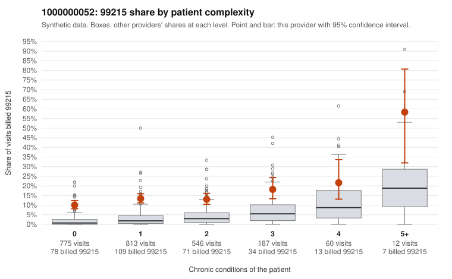

# 1000000052: High 99215 share concentrated on low-complexity patients points toward upcoding, but the documentation sample is too thin to confirm or refute it.

**Leaning (advisory):** Pattern consistent with upcoding

## Why

1000000052 billed 99215 on 13.0% of 2,393 claims against an expected 2.5% given patient complexity (risk-adjusted score 15.70; plain z-score vs peers 1.59). 60% of this provider's 99215 claims were on patients with 0 or 1 chronic conditions. Records came back for 30 claims. Of 4 documented 99215 claims, 0 (0%) were documented below the billed level, against 0% for the comparison providers. 3 of 19 notes claiming moderate-or-higher data reviewed had no lab or test line on the claim. The complexity breakdown is the strongest signal. This provider's 99215 share exceeds the all-provider share in every complexity band, including patients with zero or one chronic condition, who account for most of the 99215s. Several sampled 99215s on those patients carry only routine diagnoses: upper respiratory infection (C0030577, C0032075), follow-up encounters (C0030705, C0032365) and rash (C0031020, C0032580). That pattern is consistent with upcoding rather than a sicker panel, although the sampled high-complexity 99215s (e.g., C0032106, C0032164) look appropriate. The records review cannot settle the question: only 4 documented 99215s came back, so the absence of unsupported claims is too thin to judge, and 3 notes claiming moderate-or-higher data review with no lab or test line are weak evidence of templated or inflated notes. A reviewer should first request charts for the low-complexity 99215 claims listed, prioritizing the URI, rash and Z09 follow-up visits, and check whether the documented MDM and time reflect the actual encounter. Examples: C0030577: billed 99215, patient aged 52 with 0 chronic condition(s). C0030610: billed 99215, patient aged 26 with 1 chronic condition(s) (type 2 diabetes). C0030651: billed 99215, patient aged 52 with 1 chronic condition(s) (type 2 diabetes).

## Evidence chart

## Cited claims

`C0030577`, `C0030610`, `C0030651`

## Suggested next steps

- Request the full records for the cited claims and have a certified coder re-score each against current E/M documentation rules (medical decision making or total time).
- If the re-scoring confirms the pattern, use the sampling plan in the recovery packet to review a statistical sample of this provider's 99215 claims.
- Check whether notes for the cited claims look copied forward, and whether documented minutes repeat from visit to visit.

---
Citations checked: 3/3 valid. Synthetic data. The leaning is advisory; the flag comes from the statistical screen, and no clinical documentation is available beyond the sampled records-review facts shown in the packet.
