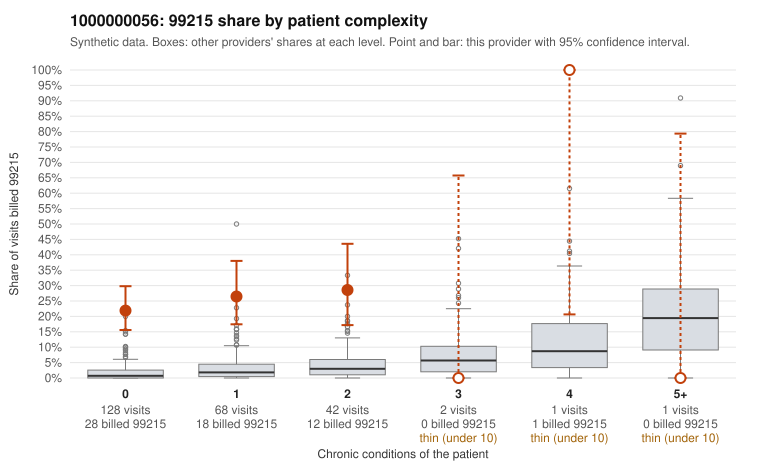

# 1000000056: Provider 1000000056 bills 99215 far above expectation, mostly on low-complexity patients, but the sampled notes support every documented 99215, so the question is whether those notes reflect real visit complexity.

**Leaning (advisory):** Inconclusive

## Why

1000000056 billed 99215 on 24.4% of 242 claims against an expected 1.9% given patient complexity (risk-adjusted score 12.16; plain z-score vs peers 3.78). 78% of this provider's 99215 claims were on patients with 0 or 1 chronic conditions. Records came back for 30 claims. Of 14 documented 99215 claims, 0 (0%) were documented below the billed level, against 0% for the comparison providers. 7 of 26 notes claiming moderate-or-higher data reviewed had no lab or test line on the claim. The billing pattern is not explained by panel acuity: most 99215s fall on patients with zero or one chronic condition and routine diagnoses such as upper respiratory infection, back pain or abdominal pain (e.g., C0034724, C0034581, C0034761), and the provider's 99215 share in every low-complexity band far exceeds the all-provider share. Against that, none of the 14 documented 99215 claims fell below the billed level, which on its face supports the coding. Some of those supported notes, however, record high MDM for visits whose claims carry minor diagnoses (C0034724 for J06.9 in a 30-year-old, C0034767 for hypothyroidism alone). Together with the notes claiming data reviewed that the claims do not show, this is weak evidence that documentation may be templated or inflated rather than proof the visits were complex. The 99214 mismatches (C0034671, C0034749) are a small count but sit above the comparison rate, and records cover only about an eighth of claims, so the documentation is suggestive rather than conclusive. A reviewer should first read the full notes for the supported low-complexity 99215s (C0034724, C0034767, C0034704) and check whether the MDM elements, time and data reviewed are specific to each visit or repeat across charts. They should then request records for more of the undocumented low-complexity 99215 claims. Examples: C0034671: billed 99214; documented MDM level low, minutes not recorded. C0034749: billed 99214; documented MDM level low, minutes not recorded. C0034539: billed 99215, patient aged 92 with 0 chronic condition(s). C0034546: billed 99215, patient aged 40 with 0 chronic condition(s).

## Evidence chart

## Cited claims

`C0034671`, `C0034749`, `C0034539`, `C0034546`

## Suggested next steps

- Request records for a larger sample of this provider's 99214 and 99215 claims; what came back is too thin to judge.
- Re-screen the provider once the records arrive.

---
Citations checked: 4/4 valid. Synthetic data. The leaning is advisory; the flag comes from the statistical screen, and no clinical documentation is available beyond the sampled records-review facts shown in the packet.
