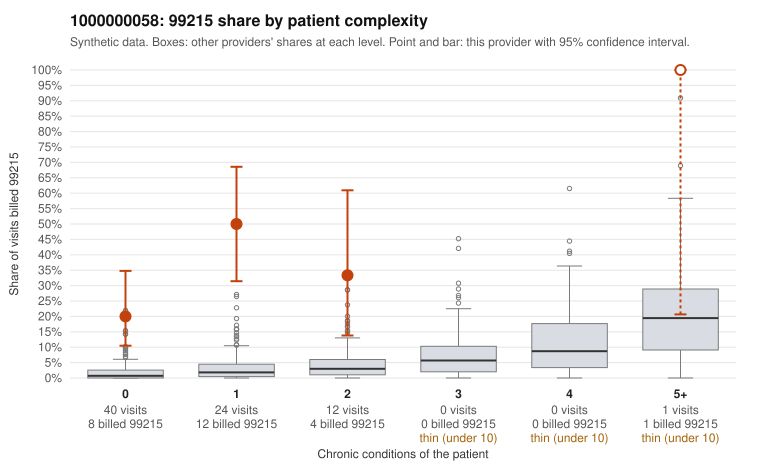

# 1000000058: Provider 1000000058 bills 99215 far above expectation, mostly on low-complexity patients, yet the few 99215 charts returned document high MDM, so the evidence conflicts.

**Leaning (advisory):** Inconclusive

## Why

1000000058 billed 99215 on 32.5% of 77 claims against an expected 1.9% given patient complexity (risk-adjusted score 9.19; plain z-score vs peers 5.34). 80% of this provider's 99215 claims were on patients with 0 or 1 chronic conditions. Records came back for 30 claims. Of 8 documented 99215 claims, 0 (0%) were documented below the billed level, against 0% for the comparison providers. 1 of 21 notes claiming moderate-or-higher data reviewed had no lab or test line on the claim. The claims data point toward upcoding: most 99215s fall on patients with 0 or 1 chronic conditions, including Z09 follow-up visits (e.g., C0034962, C0034973, C0035004) and single-diagnosis hyperlipidemia or obesity visits (e.g., C0034966, C0034963), where top-level visits would not be expected. Against that, all 8 documented 99215 claims were supported, with high MDM and roughly 33-48 minutes recorded (C0034962, C0034963, C0034966, C0035038), and only 1 data-reviewed note lacked a lab or test line. Eight charts is a thin base, and high-MDM notes on a 0-condition Z09 follow-up such as C0034962 should be checked for templated or cloned content rather than taken at face value. The elevated below-billed rates at 99213 and 99214 (e.g., C0034982, C0035028) are also notable, because they suggest the documentation does not consistently track the billed level. A reviewer should first request more 99215 charts, prioritizing the low-complexity and Z09 visits, and compare the note text across patients for copy-forward language before drawing a conclusion. Examples: C0034978: billed 99213; documented MDM level straightforward, minutes not recorded. C0034982: billed 99214; documented MDM level low, minutes not recorded. C0034958: billed 99215, patient aged 36 with 1 chronic condition(s) (hyperlipidemia). C0034959: billed 99215, patient aged 69 with 1 chronic condition(s) (hyperlipidemia).

## Evidence chart

## Cited claims

`C0034978`, `C0034982`, `C0034958`, `C0034959`

## Suggested next steps

- Request records for a larger sample of this provider's 99214 and 99215 claims; what came back is too thin to judge.
- Re-screen the provider once the records arrive.

---
Citations checked: 4/4 valid. Synthetic data. The leaning is advisory; the flag comes from the statistical screen, and no clinical documentation is available beyond the sampled records-review facts shown in the packet.
