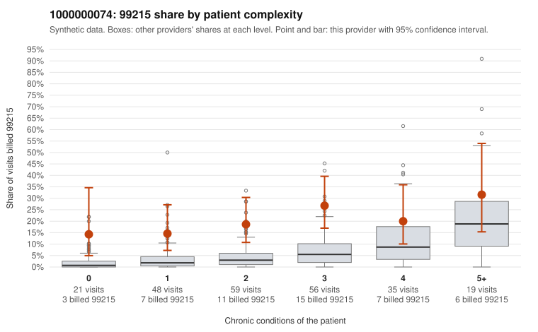

# 1000000074: 1000000074: 6 of 23 documented 99214 and 99215 claims (26%) are documented below the billed level

**Leaning (advisory):** Pattern consistent with upcoding

## Why

1000000074 billed 99215 on 20.6% of 238 claims against an expected 5.0% given patient complexity (risk-adjusted score 5.30; plain z-score vs peers 3.04). 20% of this provider's 99215 claims were on patients with 0 or 1 chronic conditions. Records came back for 30 claims. Of 4 documented 99215 claims, 3 (75%) were documented below the billed level, against 0% for the comparison providers. 2 of 19 notes claiming moderate-or-higher data reviewed had no lab or test line on the claim. This pattern is consistent with upcoding. It is a reason to review the records, not a finding. Examples: C0043082: billed 99215; documented MDM level moderate, 36 minutes. C0043089: billed 99215, patient aged 49 with 1 chronic condition(s) (hypertension); documented MDM level moderate, 31 minutes. C0043228: billed 99215, patient aged 48 with 1 chronic condition(s) (hyperlipidemia); documented MDM level moderate, 37 minutes. C0043032: billed 99215, patient aged 21 with 1 chronic condition(s) (atrial fibrillation). C0043040: billed 99215, patient aged 18 with 1 chronic condition(s) (heart failure). C0043043: billed 99215, patient aged 46 with 1 chronic condition(s) (asthma); documented MDM level high, 52 minutes.

## Evidence chart

## Cited claims

`C0043082`, `C0043089`, `C0043228`, `C0043032`, `C0043040`, `C0043043`

## Suggested next steps

- Request the full records for the cited claims and have a certified coder re-score each against current E/M documentation rules (medical decision making or total time).
- If the re-scoring confirms the pattern, use the sampling plan in the recovery packet to review a statistical sample of this provider's 99215 claims.
- Check whether notes for the cited claims look copied forward, and whether documented minutes repeat from visit to visit.

---
Citations checked: 6/6 valid. Synthetic data. The leaning is advisory; the flag comes from the statistical screen, and no clinical documentation is available beyond the sampled records-review facts shown in the packet.
