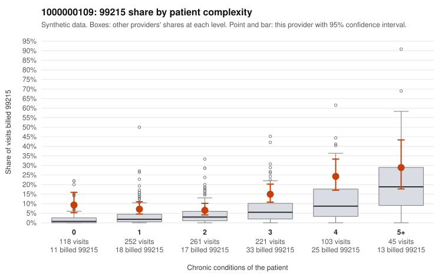

# 1000000109: Elevated 99215 use runs above expectation at every complexity level, including low-complexity patients, but records are too thin to tell upcoding from a sicker panel.

**Leaning (advisory):** Inconclusive

## Why

1000000109 billed 99215 on 11.7% of 1,000 claims against an expected 4.2% given patient complexity (risk-adjusted score 5.71; plain z-score vs peers 1.33). 25% of this provider's 99215 claims were on patients with 0 or 1 chronic conditions. Records came back for 30 claims. Of 3 documented 99215 claims, 0 (0%) were documented below the billed level, against 0% for the comparison providers. 0 of 22 notes claiming moderate-or-higher data reviewed had no lab or test line on the claim. The 99215 excess is not confined to complex patients. The share exceeds the all-provider rate in every condition band, and about a quarter of 99215s fall on patients with 0 or 1 chronic conditions. Sampled examples include visits with simple diagnoses, such as C0059105 (J06.9 only), C0059638 (N39.0 only) and C0059253 (R21 only), which is a pattern consistent with upcoding. Against that, the high-complexity samples (e.g., C0059423, C0059911) look appropriate for 99215. The documentation that exists supports the billed levels: no documented claims fell below the billed level, and the three documented 99215s, including the low-complexity C0059809, recorded high MDM. No data-reviewed red flags appeared. Three documented 99215s is far too few to judge support, so a reviewer should first request charts for the low-complexity 99215 claims listed in the packet and check whether the MDM and time actually documented justify the highest level. Examples: C0058946: billed 99215, patient aged 55 with 1 chronic condition(s) (heart failure). C0058980: billed 99215, patient aged 48 with 0 chronic condition(s).

## Evidence chart

## Cited claims

`C0058946`, `C0058980`

## Suggested next steps

- Request records for a larger sample of this provider's 99214 and 99215 claims; what came back is too thin to judge.
- Re-screen the provider once the records arrive.

---
Citations checked: 2/2 valid. Synthetic data. The leaning is advisory; the flag comes from the statistical screen, and no clinical documentation is available beyond the sampled records-review facts shown in the packet.
