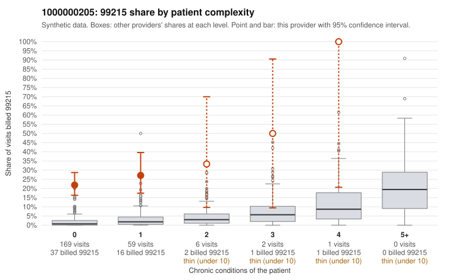

# 1000000205: Provider 1000000205 bills 99215 far above what its largely low-complexity panel would predict, a pattern consistent with upcoding, though the chart evidence is still too thin to confirm it.

**Leaning (advisory):** Pattern consistent with upcoding

## Why

1000000205 billed 99215 on 24.1% of 237 claims against an expected 1.5% given patient complexity (risk-adjusted score 13.41; plain z-score vs peers 3.71). 93% of this provider's 99215 claims were on patients with 0 or 1 chronic conditions. Records came back for 30 claims. Of 3 documented 99215 claims, 3 (100%) were documented below the billed level, against 0% for the comparison providers. 1 of 20 notes claiming moderate-or-higher data reviewed had no lab or test line on the claim. The strongest signal is the complexity mismatch: nearly all 99215 claims fall on patients with zero or one chronic condition, and the sampled examples are routine presentations such as back pain, abdominal pain, rash, UTI and URI (C0102078, C0102090, C0102167). That is the opposite of what a sicker panel would show, and the one high-complexity 99215 in the sample (C0102313) is the exception. The chart review points the same way, since all three documented 99215 claims were documented at moderate MDM, including C0102232 on a patient with only obesity. But three charts is too few to judge on their own, and the code rule check also flags the pooled documentation result as not lopsided. The 99213 and 99214 charts largely supported their billed levels, and only 1 of 20 notes claiming moderate-or-higher data review lacked a lab or test line, so there is little sign of cloned notes. A reviewer should first request more 99215 charts, especially for low-complexity patients like those listed, to test whether the documented MDM or time supports the level billed. Examples: C0102072: billed 99215; documented MDM level moderate, minutes not recorded. C0102232: billed 99215, patient aged 65 with 1 chronic condition(s) (obesity); documented MDM level moderate, minutes not recorded. C0102315: billed 99215; documented MDM level moderate, minutes not recorded. C0102073: billed 99215, patient aged 44 with 1 chronic condition(s) (hypothyroidism). C0102078: billed 99215, patient aged 37 with 0 chronic condition(s). C0102090: billed 99215, patient aged 18 with 0 chronic condition(s).

## Evidence chart

## Cited claims

`C0102072`, `C0102232`, `C0102315`, `C0102073`, `C0102078`, `C0102090`

## Suggested next steps

- Request the full records for the cited claims and have a certified coder re-score each against current E/M documentation rules (medical decision making or total time).
- If the re-scoring confirms the pattern, use the sampling plan in the recovery packet to review a statistical sample of this provider's 99215 claims.
- Check whether notes for the cited claims look copied forward, and whether documented minutes repeat from visit to visit.

---
Citations checked: 6/6 valid. Synthetic data. The leaning is advisory; the flag comes from the statistical screen, and no clinical documentation is available beyond the sampled records-review facts shown in the packet.
