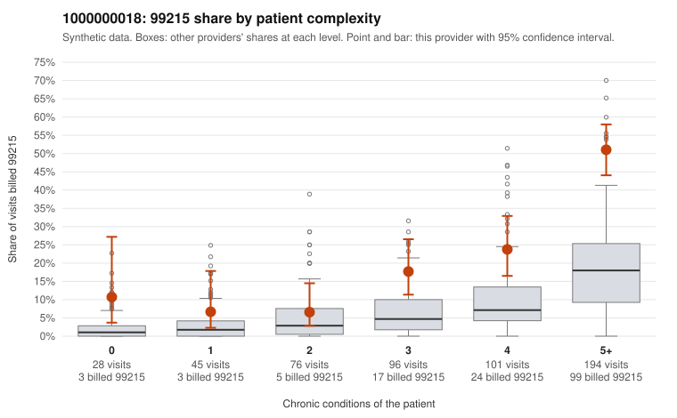

# 1000000018: Provider 1000000018's 99215 rate stays well above expected even after risk adjustment, but the few charts returned support the billed levels, so the pattern is unresolved.

**Leaning (advisory):** Inconclusive

## Why

1000000018 billed 99215 on 28.0% of 540 claims against an expected 7.3% given patient complexity (risk-adjusted score 6.85; plain z-score vs peers 4.17). 4% of this provider's 99215 claims were on patients with 0 or 1 chronic conditions. Records came back for 30 claims. Of 9 documented 99215 claims, 0 (0%) were documented below the billed level, against 11% for the comparison providers. 2 of 23 notes claiming moderate-or-higher data reviewed had no lab or test line on the claim. The panel is genuinely complex: most 99215s fall on patients with 5+ conditions, and few are on low-complexity patients. Yet the 99215 share runs roughly two to five times the all-provider share in every complexity band, including patients with 0 conditions, so panel acuity alone does not explain the excess. The documentation points the other way: none of the 9 documented 99215 claims was below the billed level, and only 2 of 23 notes had moderate-plus data reviewed without a lab line, which is a weak signal of inflated notes. Nine charts is too few to outweigh a strong risk-adjusted excess, and the notes could still match the billing without matching the visit. A reviewer should first request charts for the sampled low-complexity 99215s, such as C0012483 and C0012524 (same patient, no chronic conditions, back pain and urinary diagnoses) and C0012538 (Z09 follow-up only), then widen the records sample for 99215s in the 3–5+ condition bands to see whether the high MDM documentation holds up. Examples: C0012465: billed 99214; documented MDM level low, minutes not recorded. C0012400: billed 99215, patient aged 18 with 1 chronic condition(s) (COPD). C0012483: billed 99215, patient aged 62 with 0 chronic condition(s).

## Evidence chart

## Cited claims

`C0012465`, `C0012400`, `C0012483`

## Suggested next steps

- Request records for a larger sample of this provider's 99214 and 99215 claims; what came back is too thin to judge.
- Re-screen the provider once the records arrive.

---
Citations checked: 3/3 valid. Synthetic data. The leaning is advisory; the flag comes from the statistical screen, and no clinical documentation is available beyond the sampled records-review facts shown in the packet.
