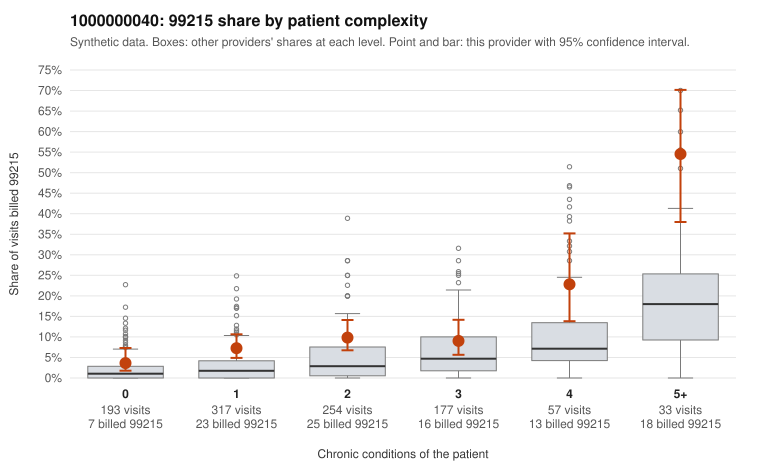

# 1000000040: Provider 1000000040 bills 99215 at roughly three times the complexity-adjusted expectation, with elevated rates even among low-complexity patients, but only two 99215 claims have records, too few to tell upcoding from a sicker panel.

**Leaning (advisory):** Inconclusive

## Why

1000000040 billed 99215 on 9.9% of 1,031 claims against an expected 3.2% given patient complexity (risk-adjusted score 4.53; plain z-score vs peers 0.90). 29% of this provider's 99215 claims were on patients with 0 or 1 chronic conditions. Records came back for 30 claims. Of 2 documented 99215 claims, 0 (0%) were documented below the billed level, against 11% for the comparison providers. 2 of 18 notes claiming moderate-or-higher data reviewed had no lab or test line on the claim. The billing pattern raises concern because 99215 rates exceed the all-provider share in every complexity band. Nearly a third of 99215s fall on patients with zero or one chronic condition, including sampled claims for simple presentations such as C0022341 (J06.9 only), C0022250 (N39.0 only) and C0022284 (M54.50 only). At the same time, the steep rise in 99215 share at 4 and 5+ conditions, and sampled claims like C0022230 and C0023166, show part of the volume sits on genuinely complex patients. The plain peer z-score is modest. The documentation does not settle the question: both documented 99215s (C0022337, C0022923) supported high MDM, and no documented claim at any level fell below the billed level, but two charts cannot confirm or refute a pattern. The 2 of 18 data-reviewed notes without a lab or test line are only weak evidence of inflated notes. A reviewer should first request records for the low-complexity 99215 claims listed here, especially the zero-condition ones, to check whether high MDM and time are actually documented. Examples: C0022188: billed 99215, patient aged 94 with 1 chronic condition(s) (hypertension). C0022189: billed 99215, patient aged 51 with 1 chronic condition(s) (obesity).

## Evidence chart

## Cited claims

`C0022188`, `C0022189`

## Suggested next steps

- Request records for a larger sample of this provider's 99214 and 99215 claims; what came back is too thin to judge.
- Re-screen the provider once the records arrive.

---
Citations checked: 2/2 valid. Synthetic data. The leaning is advisory; the flag comes from the statistical screen, and no clinical documentation is available beyond the sampled records-review facts shown in the packet.
