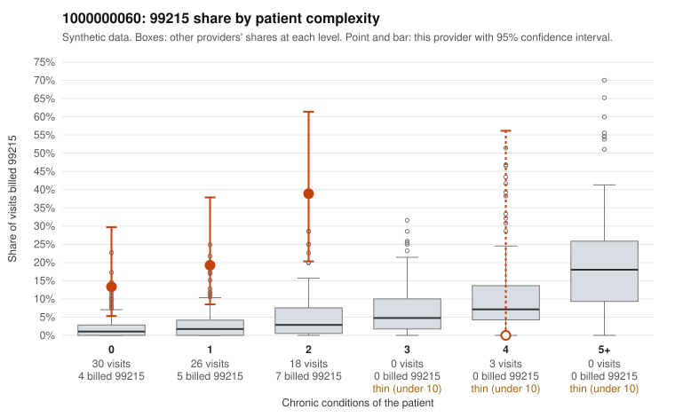

# 1000000060: Provider 1000000060's elevated 99215 billing is concentrated on low-complexity patients, but the few charts returned for 99215 claims support the billed level, so the evidence is mixed.

**Leaning (advisory):** Inconclusive

## Why

1000000060 billed 99215 on 20.8% of 77 claims against an expected 2.1% given patient complexity (risk-adjusted score 4.15; plain z-score vs peers 2.87). 56% of this provider's 99215 claims were on patients with 0 or 1 chronic conditions. Records came back for 30 claims. Of 4 documented 99215 claims, 0 (0%) were documented below the billed level, against 11% for the comparison providers. 1 of 20 notes claiming moderate-or-higher data reviewed had no lab or test line on the claim. The billing-versus-complexity picture fits upcoding: the 99215 excess sits mostly on patients with 0 to 1 chronic conditions, none of the 4-condition visits were billed 99215, and sampled low-complexity 99215 claims carry simple diagnoses such as follow-up (Z09 on C0030294 and C0030334), rash (R21 on C0030302) and unspecified abdominal pain (R10.9 on C0030268). The documentation does not confirm this, though. All 4 documented 99215 claims (C0030257, C0030289, C0030306 and C0030313) record high MDM, three with recorded minutes, and only 1 of 20 moderate-plus data notes lacks a lab or test line, which is a weak signal of cloned or inflated notes. With only 4 documented 99215 claims, the documentation is too thin to settle the question, and the support it shows could mean either a truly complex visit pattern or notes written to match the billed level. A reviewer should first request charts for the undocumented low-complexity 99215 claims, starting with the Z09, R21 and R10.9 visits. Those notes should be checked for whether the high-MDM elements (problems addressed, data reviewed, risk) are specific to the encounter or templated. Examples: C0030308: billed 99213; documented MDM level straightforward, minutes not recorded. C0030262: billed 99215, patient aged 18 with 1 chronic condition(s) (type 2 diabetes). C0030268: billed 99215, patient aged 38 with 0 chronic condition(s).

## Evidence chart

## Cited claims

`C0030308`, `C0030262`, `C0030268`

## Suggested next steps

- Request records for a larger sample of this provider's 99214 and 99215 claims; what came back is too thin to judge.
- Re-screen the provider once the records arrive.

---
Citations checked: 3/3 valid. Synthetic data. The leaning is advisory; the flag comes from the statistical screen, and no clinical documentation is available beyond the sampled records-review facts shown in the packet.
