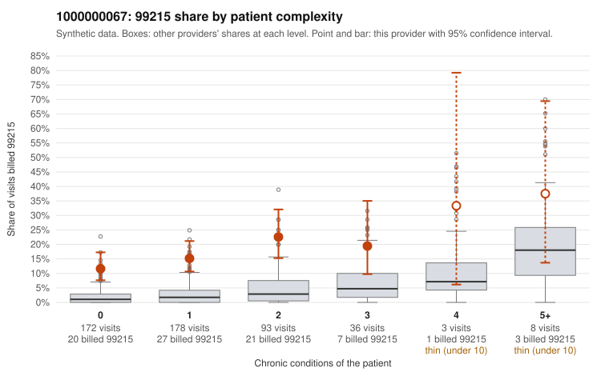

# 1000000067: 1000000067: 5 of 20 documented 99214 and 99215 claims (25%) are documented below the billed level

**Leaning (advisory):** Pattern consistent with upcoding

## Why

1000000067 billed 99215 on 16.1% of 490 claims against an expected 2.3% given patient complexity (risk-adjusted score 7.53; plain z-score vs peers 2.03). 59% of this provider's 99215 claims were on patients with 0 or 1 chronic conditions. Records came back for 30 claims. Of 4 documented 99215 claims, 3 (75%) were documented below the billed level, against 11% for the comparison providers. 1 of 16 notes claiming moderate-or-higher data reviewed had no lab or test line on the claim. This pattern is consistent with upcoding. It is a reason to review the records, not a finding. Examples: C0035079: billed 99215; documented MDM level moderate, 37 minutes. C0035267: billed 99215; documented MDM level moderate, minutes not recorded. C0035419: billed 99215, patient aged 55 with 0 chronic condition(s); documented MDM level moderate, 30 minutes. C0035056: billed 99215, patient aged 41 with 1 chronic condition(s) (hypertension). C0035074: billed 99215, patient aged 30 with 1 chronic condition(s) (hypothyroidism). C0035083: billed 99215, patient aged 65 with 1 chronic condition(s) (chronic kidney disease).

## Evidence chart

## Cited claims

`C0035079`, `C0035267`, `C0035419`, `C0035056`, `C0035074`, `C0035083`

## Suggested next steps

- Request the full records for the cited claims and have a certified coder re-score each against current E/M documentation rules (medical decision making or total time).
- If the re-scoring confirms the pattern, use the sampling plan in the recovery packet to review a statistical sample of this provider's 99215 claims.
- Check whether notes for the cited claims look copied forward, and whether documented minutes repeat from visit to visit.

---
Citations checked: 6/6 valid. Synthetic data. The leaning is advisory; the flag comes from the statistical screen, and no clinical documentation is available beyond the sampled records-review facts shown in the packet.
