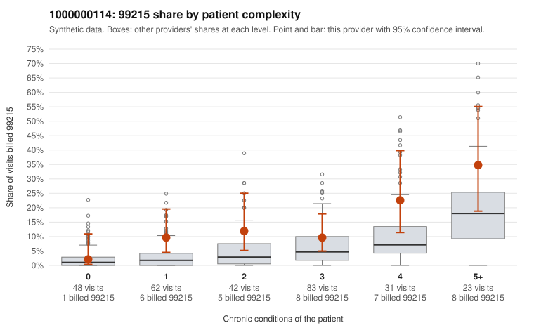

# 1000000114: Provider 1000000114 bills 99215 well above its risk-adjusted expectation, including on low-complexity patients, but only three documented 99215 claims exist, so the records cannot confirm or rule out upcoding.

**Leaning (advisory):** Inconclusive

## Why

1000000114 billed 99215 on 12.1% of 289 claims against an expected 4.2% given patient complexity (risk-adjusted score 2.46; plain z-score vs peers 1.30). 20% of this provider's 99215 claims were on patients with 0 or 1 chronic conditions. Records came back for 30 claims. Of 3 documented 99215 claims, 1 (33%) were documented below the billed level, against 11% for the comparison providers. 1 of 22 notes claiming moderate-or-higher data reviewed had no lab or test line on the claim. The excess 99215 billing is not explained by panel acuity alone. The elevated share shows up at every complexity level with one or more conditions, and the low-complexity sample includes 99215s on single-condition or no-condition patients (e.g., C0061966, C0062047, C0062102, C0062193). The high-complexity sample does show genuinely multimorbid patients where 99215 is plausible (e.g., C0062100, C0062150). The documentation is too thin to judge: one of three documented 99215s (C0062000) was below the billed level, and one low-complexity 99215 (C0061966) was documented at high MDM, so neither direction is established. The 99213/99214 records were fully supported, and only 1 of 22 data-reviewed notes lacked a lab line, which gives little sign of inflated notes. A reviewer should first request charts for the sampled low-complexity 99215 claims, starting with C0062193, C0062047 and C0062102, to test whether those visits truly reflect high-complexity decision-making. Examples: C0062000: billed 99215; documented MDM level moderate, minutes not recorded. C0061917: billed 99215, patient aged 60 with 1 chronic condition(s) (COPD). C0061966: billed 99215, patient aged 43 with 1 chronic condition(s) (obesity); documented MDM level high, minutes not recorded.

## Evidence chart

## Cited claims

`C0062000`, `C0061917`, `C0061966`

## Suggested next steps

- Request records for a larger sample of this provider's 99214 and 99215 claims; what came back is too thin to judge.
- Re-screen the provider once the records arrive.

---
Citations checked: 3/3 valid. Synthetic data. The leaning is advisory; the flag comes from the statistical screen, and no clinical documentation is available beyond the sampled records-review facts shown in the packet.
