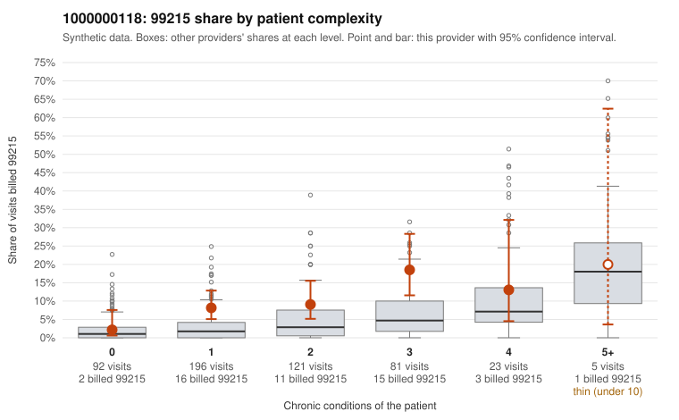

# 1000000118: Provider 1000000118's 99215 excess falls mostly on 1–3 condition patients, but the few documented 99215 charts support the billed level, while 99214 claims show a notable unsupported rate.

**Leaning (advisory):** Inconclusive

## Why

1000000118 billed 99215 on 9.3% of 518 claims against an expected 2.8% given patient complexity (risk-adjusted score 3.22; plain z-score vs peers 0.79). 38% of this provider's 99215 claims were on patients with 0 or 1 chronic conditions. Records came back for 30 claims. Of 5 documented 99215 claims, 0 (0%) were documented below the billed level, against 11% for the comparison providers. 2 of 21 notes claiming moderate-or-higher data reviewed had no lab or test line on the claim. The elevated 99215 share is concentrated in patients with one to three conditions, and over a third of 99215s went to low-complexity patients, including simple-sounding visits such as C0063790 (upper respiratory infection, no chronic conditions) and C0063777 (urinary diagnosis only). That pattern is consistent with upcoding, but the five documented 99215 charts all support high MDM, including low-complexity sample claim C0064068 (high MDM, 47 minutes), so the 99215 documentation is too thin to confirm or refute. The stronger documentation signal is at 99214, which dominates this provider's mix: about one in five documented 99214 claims were documented below the billed level, well above the all-provider rate, with examples such as C0063604, C0063665, C0063685 and C0064009 documented at low MDM. The data-reviewed mismatch involves only 2 of 21 notes and is weak evidence. A reviewer should first request more charts, prioritizing the low-complexity 99215 claims listed and a larger sample of 99214 claims, and check whether high-MDM notes look templated or cloned relative to the diagnoses billed. Examples: C0063604: billed 99214; documented MDM level low, minutes not recorded. C0063665: billed 99214; documented MDM level low, 26 minutes. C0063611: billed 99215, patient aged 43 with 1 chronic condition(s) (depression). C0063673: billed 99215, patient aged 45 with 1 chronic condition(s) (obesity).

## Evidence chart

## Cited claims

`C0063604`, `C0063665`, `C0063611`, `C0063673`

## Suggested next steps

- Request records for a larger sample of this provider's 99214 and 99215 claims; what came back is too thin to judge.
- Re-screen the provider once the records arrive.

---
Citations checked: 4/4 valid. Synthetic data. The leaning is advisory; the flag comes from the statistical screen, and no clinical documentation is available beyond the sampled records-review facts shown in the packet.
