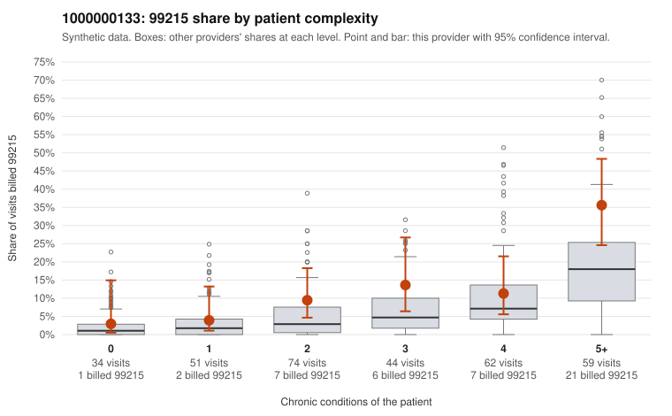

# 1000000133: Provider 1000000133 bills 99215 at about two and a half times the risk-adjusted expectation, but the excess sits mostly on multi-morbid patients and the few charts returned support the billed levels, so the picture is inconclusive.

**Leaning (advisory):** Inconclusive

## Why

1000000133 billed 99215 on 13.6% of 324 claims against an expected 5.4% given patient complexity (risk-adjusted score 2.37; plain z-score vs peers 1.57). 7% of this provider's 99215 claims were on patients with 0 or 1 chronic conditions. Records came back for 30 claims. Of 3 documented 99215 claims, 0 (0%) were documented below the billed level, against 11% for the comparison providers. 2 of 18 notes claiming moderate-or-higher data reviewed had no lab or test line on the claim. The elevated 99215 share is concentrated in patients with 5+ conditions and, to a lesser degree, 2-3 conditions. Only a small share of 99215s fall on 0-1 condition patients, which leans toward a sicker panel rather than indiscriminate upcoding. The sampled high-complexity 99215s (e.g., C0069447, C0069699, C0069748) carry multiple chronic diagnoses consistent with complex visits. Low-complexity 99215s like C0069733 (no chronic conditions, J06.9 upper respiratory infection) and C0069543 (hyperlipidemia only) are the cases that warrant a look. The documentation cannot settle the question: only 3 documented 99215 claims came back, all supported (C0069489, C0069503, C0069558), and that is too thin to rule upcoding in or out. The 2 notes claiming moderate-plus data review without a lab or test line are only weak evidence of possible note inflation. A reviewer should first request charts for the low-complexity 99215s (C0069733, C0069543, C0069556) and for a larger sample of 99215s on 2-3 condition patients, checking whether the MDM is genuinely high or templated. Examples: C0069543: billed 99215, patient aged 38 with 1 chronic condition(s) (hyperlipidemia). C0069556: billed 99215, patient aged 79 with 1 chronic condition(s) (asthma).

## Evidence chart

## Cited claims

`C0069543`, `C0069556`

## Suggested next steps

- Request records for a larger sample of this provider's 99214 and 99215 claims; what came back is too thin to judge.
- Re-screen the provider once the records arrive.

---
Citations checked: 2/2 valid. Synthetic data. The leaning is advisory; the flag comes from the statistical screen, and no clinical documentation is available beyond the sampled records-review facts shown in the packet.
