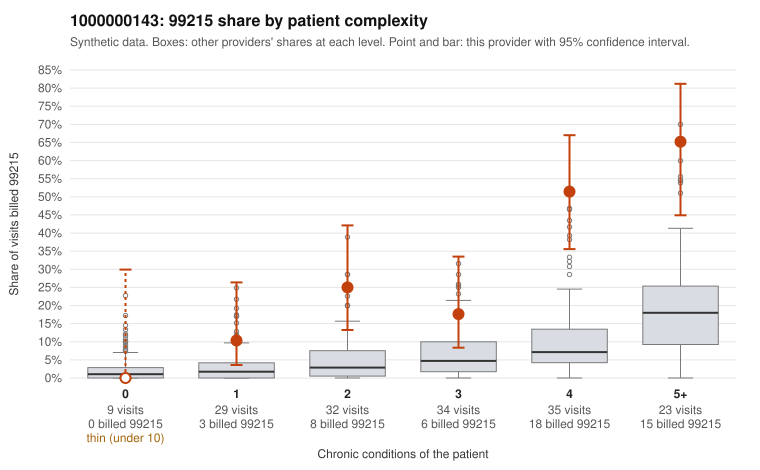

# 1000000143: Provider 1000000143 bills 99215 far above risk-adjusted expectation, yet most of that excess falls on multi-morbid patients and the thin documentation sample neither clearly supports nor clearly refutes the billed levels.

**Leaning (advisory):** Inconclusive

## Why

1000000143 billed 99215 on 30.9% of 162 claims against an expected 5.3% given patient complexity (risk-adjusted score 5.37; plain z-score vs peers 4.69). 6% of this provider's 99215 claims were on patients with 0 or 1 chronic conditions. Records came back for 30 claims. Of 9 documented 99215 claims, 2 (22%) were documented below the billed level, against 11% for the comparison providers. 0 of 19 notes claiming moderate-or-higher data reviewed had no lab or test line on the claim. The 99215 share rises steeply with condition count, and most 99215s land on patients with four or more chronic conditions, such as sampled claims C0071602 and C0071657, with few on low-complexity patients. That pattern fits a sicker panel, but the share in every complexity stratum still runs well above the all-provider share, so complexity alone does not explain the excess the risk-adjusted score already accounts for. Documentation leans mildly against the billing but is too thin to settle the question. Only nine 99215 charts came back. The two unsupported ones (C0071646 and C0071647, both documented at moderate MDM) give a rate about double the comparison rate, but a single chart either way would move it substantially, and the rule check places it between cutoffs. There is no sign of data-reviewed inflation on claims lacking test lines. A reviewer should first request more 99215 records, prioritizing the low-complexity claims C0071624, C0071729 and C0071742, and check whether high-MDM notes like C0071606 and C0071633 show substantive, patient-specific decision-making rather than templated text, since most supported notes have no time recorded. Examples: C0071646: billed 99215; documented MDM level moderate, 31 minutes. C0071647: billed 99215; documented MDM level moderate, minutes not recorded. C0071624: billed 99215, patient aged 64 with 1 chronic condition(s) (hypertension). C0071729: billed 99215, patient aged 18 with 1 chronic condition(s) (atrial fibrillation).

## Evidence chart

## Cited claims

`C0071646`, `C0071647`, `C0071624`, `C0071729`

## Suggested next steps

- Request records for a larger sample of this provider's 99214 and 99215 claims; what came back is too thin to judge.
- Re-screen the provider once the records arrive.

---
Citations checked: 4/4 valid. Synthetic data. The leaning is advisory; the flag comes from the statistical screen, and no clinical documentation is available beyond the sampled records-review facts shown in the packet.
