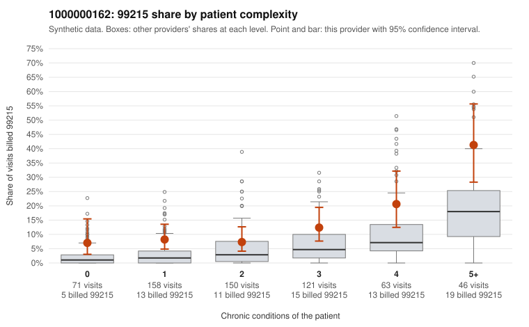

# 1000000162: Provider 1000000162 bills 99215 well above expectation in every complexity tier, but the few returned charts support the billed level, so the records are too thin to call this upcoding.

**Leaning (advisory):** Inconclusive

## Why

1000000162 billed 99215 on 12.5% of 609 claims against an expected 4.0% given patient complexity (risk-adjusted score 3.93; plain z-score vs peers 1.37). 24% of this provider's 99215 claims were on patients with 0 or 1 chronic conditions. Records came back for 30 claims. Of 5 documented 99215 claims, 0 (0%) were documented below the billed level, against 11% for the comparison providers. 1 of 20 notes claiming moderate-or-higher data reviewed had no lab or test line on the claim. The elevated 99215 rate is not confined to sicker patients. It runs at roughly two to three times the all-provider share in every complexity tier, including patients with 0 or 1 conditions. That points to a provider-wide billing habit rather than a panel-driven effect. The records review cuts the other way: the handful of documented 99215s all support the billed level, and only one note claiming moderate-or-higher data review lacked a lab or test line. However, with so few documented 99215 claims, the sample is too small to be reassuring. Two of the supported examples are low-complexity visits documented as high MDM: C0082488 (no chronic conditions, abdominal pain, minutes not recorded) and C0082768. Patient M0034839, who has only hyperlipidemia, appears on three sampled 99215s (C0082702, C0082768, C0082771). Charts that consistently read high MDM for simple presentations could reflect genuinely complex acute visits or templated documentation. A reviewer should first request charts for the low-complexity 99215 claims, starting with M0034839's visits and the 0-condition visits (C0082395, C0082465, C0082728, C0082909). They should then check whether the high-MDM notes are individualized and whether time is recorded. Examples: C0082387: billed 99215, patient aged 57 with 1 chronic condition(s) (chronic kidney disease). C0082395: billed 99215, patient aged 39 with 0 chronic condition(s).

## Evidence chart

## Cited claims

`C0082387`, `C0082395`

## Suggested next steps

- Request records for a larger sample of this provider's 99214 and 99215 claims; what came back is too thin to judge.
- Re-screen the provider once the records arrive.

---
Citations checked: 2/2 valid. Synthetic data. The leaning is advisory; the flag comes from the statistical screen, and no clinical documentation is available beyond the sampled records-review facts shown in the packet.
