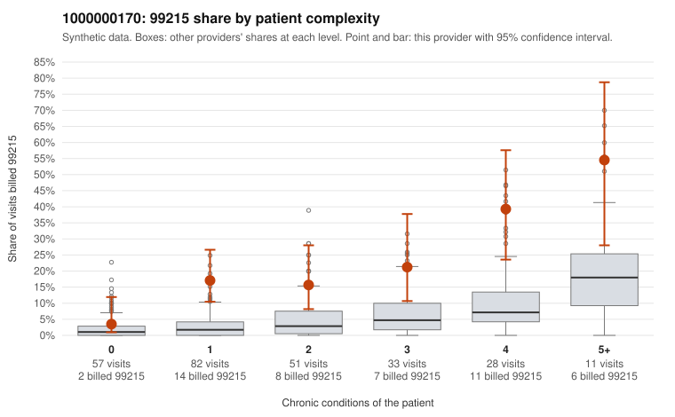

# 1000000170: Provider 1000000170's elevated 99215 rate extends to low-complexity patients, but the few 99215 charts returned all support the billed level, so the pattern is unresolved.

**Leaning (advisory):** Inconclusive

## Why

1000000170 billed 99215 on 18.3% of 262 claims against an expected 3.4% given patient complexity (risk-adjusted score 4.98; plain z-score vs peers 2.43). 33% of this provider's 99215 claims were on patients with 0 or 1 chronic conditions. Records came back for 30 claims. Of 7 documented 99215 claims, 0 (0%) were documented below the billed level, against 11% for the comparison providers. 3 of 23 notes claiming moderate-or-higher data reviewed had no lab or test line on the claim. The 99215 share is elevated in every complexity stratum, not just among multi-condition patients, and a third of 99215s fall on patients with 0 or 1 conditions. Sampled examples include repeat 99215s for a single stable condition, such as hypertension-only visits C0090315 and C0090437 for the same patient and hypothyroidism visits C0090311 and C0090389. Together with a mix dominated by 99214 and no 99211 or 99212 claims, this is consistent with level inflation. Against that, all 7 documented 99215 claims supported the billed level, including low-complexity C0090267 (0 conditions, back pain) documented at high MDM. That is too few charts to rule out a complex panel or to establish one, and a high-MDM note on an uncomplicated back-pain visit could reflect inflated or templated documentation as easily as true complexity. The no-lab mismatch on 3 of 23 data-reviewed notes is only weak evidence of cloning. The reviewer should first request more 99215 charts, prioritizing the low-complexity sample (starting with C0090267, C0090315/C0090437 and C0090311/C0090389), and compare their note text for templated or copied content. Examples: C0090199: billed 99214; documented MDM level low, 28 minutes. C0090195: billed 99215, patient aged 30 with 1 chronic condition(s) (obesity). C0090239: billed 99215, patient aged 52 with 1 chronic condition(s) (chronic kidney disease).

## Evidence chart

## Cited claims

`C0090199`, `C0090195`, `C0090239`

## Suggested next steps

- Request records for a larger sample of this provider's 99214 and 99215 claims; what came back is too thin to judge.
- Re-screen the provider once the records arrive.

---
Citations checked: 3/3 valid. Synthetic data. The leaning is advisory; the flag comes from the statistical screen, and no clinical documentation is available beyond the sampled records-review facts shown in the packet.
