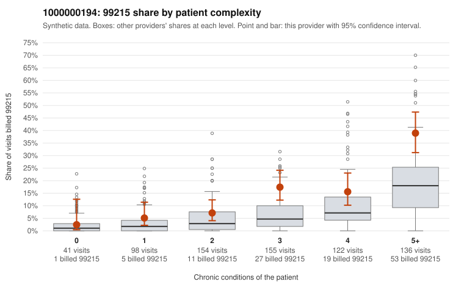

# 1000000194: Elevated 99215 billing for provider 1000000194 is concentrated in multi-morbid patients, but documentation is too thin to confirm or rule out upcoding.

**Leaning (advisory):** Inconclusive

## Why

1000000194 billed 99215 on 16.4% of 706 claims against an expected 5.7% given patient complexity (risk-adjusted score 4.57; plain z-score vs peers 2.08). 5% of this provider's 99215 claims were on patients with 0 or 1 chronic conditions. Records came back for 30 claims. Of 3 documented 99215 claims, 0 (0%) were documented below the billed level, against 11% for the comparison providers. 1 of 20 notes claiming moderate-or-higher data reviewed had no lab or test line on the claim. The excess 99215 billing sits mostly with complex patients: the 5+ condition and 3-condition groups carry shares well above the all-provider rates, while 0–1 condition visits run close to peer rates. This pattern is more consistent with a sicker panel than with across-the-board inflation, and sampled 99215 claims such as C0100740 and C0100141 show substantial chronic burden. Still, the provider bills above peers within nearly every complexity group, and low-complexity 99215s do occur (for example C0100585, with no chronic conditions and a back-pain diagnosis). Records came back for only 3 of the 99215 claims, so they cannot settle the question, even though all 3 supported high MDM (C0100633, C0100780, C0100826). The 99214 tier deserves a look, since 2 documented 99214s came back as low MDM (C0100438, C0100622), above the comparison rate on a small base. A reviewer should first request a larger chart sample focused on 99215 claims, prioritizing the low-complexity ones, and should check the within-stratum excess at 3 and 5+ conditions for templated or cloned notes. Examples: C0100438: billed 99214; documented MDM level low, minutes not recorded. C0100622: billed 99214; documented MDM level low, minutes not recorded. C0100364: billed 99215, patient aged 26 with 1 chronic condition(s) (osteoarthritis). C0100377: billed 99215, patient aged 53 with 1 chronic condition(s) (hypothyroidism).

## Evidence chart

## Cited claims

`C0100438`, `C0100622`, `C0100364`, `C0100377`

## Suggested next steps

- Request records for a larger sample of this provider's 99214 and 99215 claims; what came back is too thin to judge.
- Re-screen the provider once the records arrive.

---
Citations checked: 4/4 valid. Synthetic data. The leaning is advisory; the flag comes from the statistical screen, and no clinical documentation is available beyond the sampled records-review facts shown in the packet.
