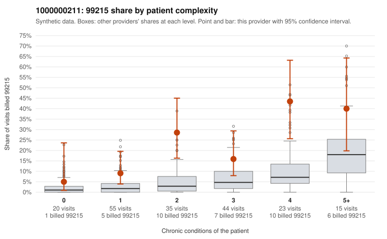

# 1000000211: Provider 1000000211 bills 99215 far above its risk-adjusted expectation, but the small set of returned charts supports the billed levels, so the pattern is unresolved.

**Leaning (advisory):** Inconclusive

## Why

1000000211 billed 99215 on 20.3% of 192 claims against an expected 4.2% given patient complexity (risk-adjusted score 4.15; plain z-score vs peers 2.79). 15% of this provider's 99215 claims were on patients with 0 or 1 chronic conditions. Records came back for 30 claims. Of 6 documented 99215 claims, 0 (0%) were documented below the billed level, against 11% for the comparison providers. 0 of 21 notes claiming moderate-or-higher data reviewed had no lab or test line on the claim. The excess 99215 share persists after risk adjustment and shows up in every complexity stratum, most sharply among two-condition patients (28.6% vs 5.3% for all providers). The mix is also compressed toward the top, with no 99211 or 99212 and most claims at 99214, which favors upcoding. Against that, none of the documented 99213, 99214 or 99215 claims fell below the billed level, and there is no cloning signal from data-reviewed notes without lab lines. One low-complexity 99215 (C0110619, a single-condition depression patient) was documented at high MDM. The documentation evidence is thin, though: only 6 documented 99215 claims, and two of the supported examples (C0110619, C0110675) have no recorded minutes. That is too few to rule out a higher unsupported rate or notes written to match the billed level. A reviewer should first request charts for more 99215 claims, prioritizing the low-complexity sample (C0110564, C0110609, C0110649, C0110705, C0110706), and check whether the high-MDM notes reflect real problem complexity and risk or templated language. Examples: C0110564: billed 99215, patient aged 39 with 1 chronic condition(s) (type 2 diabetes). C0110609: billed 99215, patient aged 31 with 1 chronic condition(s) (hypertension).

## Evidence chart

## Cited claims

`C0110564`, `C0110609`

## Suggested next steps

- Request records for a larger sample of this provider's 99214 and 99215 claims; what came back is too thin to judge.
- Re-screen the provider once the records arrive.

---
Citations checked: 2/2 valid. Synthetic data. The leaning is advisory; the flag comes from the statistical screen, and no clinical documentation is available beyond the sampled records-review facts shown in the packet.
