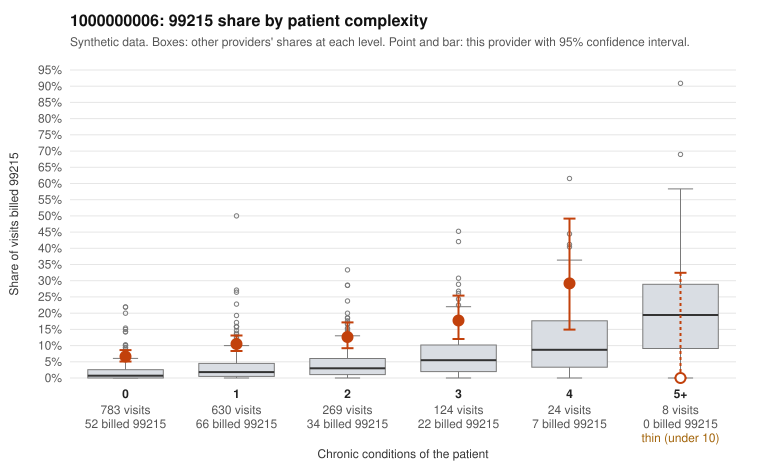

# 1000000006: Provider 1000000006's 99215 excess is concentrated in low-complexity visits, which is consistent with upcoding, but only six documented 99215 claims leave the records evidence too thin to confirm it.

**Leaning (advisory):** Inconclusive

## Why

1000000006 billed 99215 on 9.8% of 1,838 claims against an expected 2.2% given patient complexity (risk-adjusted score 10.65; plain z-score vs peers 0.97). 65% of this provider's 99215 claims were on patients with 0 or 1 chronic conditions. Records came back for 30 claims. Of 6 documented 99215 claims, 1 (17%) were documented below the billed level, against 0% for the comparison providers. 2 of 16 notes claiming moderate-or-higher data reviewed had no lab or test line on the claim. The billing pattern is the main concern. The 99215 share is elevated in every complexity band, and most 99215s go to patients with zero or one chronic condition. The sampled low-complexity 99215s are often single acute or follow-up diagnoses such as J06.9, N39.0, R21 and Z09 (e.g., C0002229, C0002395, C0003125). That pattern is consistent with upcoding rather than a sicker panel, and the sampled high-complexity 99215s (e.g., C0002457, C0002635) look appropriately coded. The documentation does not settle it. Only 6 documented 99215 claims exist: one is unsupported (C0002617, a diabetes visit documented at moderate MDM), and others are supported at high MDM, including C0003609, a J06.9 visit on a 24-year-old with 52 minutes recorded. Full time-based support on a routine URI is plausible but unusual, and the 2 data-reviewed notes with no lab line add only weak cloning concern. A reviewer should first request charts for more low-complexity 99215s, prioritizing the sampled acute-diagnosis claims, and check whether the high-MDM and time statements in those notes are individualized or templated. Examples: C0002617: billed 99215, patient aged 39 with 1 chronic condition(s) (type 2 diabetes); documented MDM level moderate, minutes not recorded. C0002229: billed 99215, patient aged 20 with 0 chronic condition(s). C0002395: billed 99215, patient aged 37 with 0 chronic condition(s).

## Evidence chart

## Cited claims

`C0002617`, `C0002229`, `C0002395`

## Suggested next steps

- Request records for a larger sample of this provider's 99214 and 99215 claims; what came back is too thin to judge.
- Re-screen the provider once the records arrive.

---
Citations checked: 3/3 valid. Synthetic data. The leaning is advisory; the flag comes from the statistical screen, and no clinical documentation is available beyond the sampled records-review facts shown in the packet.
