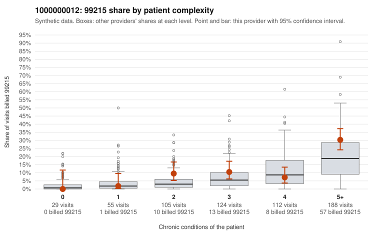

# 1000000012: 1000000012: too few returned records to judge

**Leaning (advisory):** Inconclusive

## Why

1000000012 billed 99215 on 14.5% of 613 claims against an expected 8.5% given patient complexity (risk-adjusted score 2.65; plain z-score vs peers 1.87). 1% of this provider's 99215 claims were on patients with 0 or 1 chronic conditions. Records came back for 0 claims. No documented 99215 claims came back. The evidence does not support a call either way yet. Examples: C0006540: billed 99215, patient aged 57 with 1 chronic condition(s) (osteoarthritis).

## Evidence chart

## Cited claims

`C0006540`

## Suggested next steps

- Request records for a larger sample of this provider's 99214 and 99215 claims; what came back is too thin to judge.
- Re-screen the provider once the records arrive.

---
Citations checked: 1/1 valid. Synthetic data. The leaning is advisory; the flag comes from the statistical screen, and no clinical documentation is available beyond the sampled records-review facts shown in the packet.
