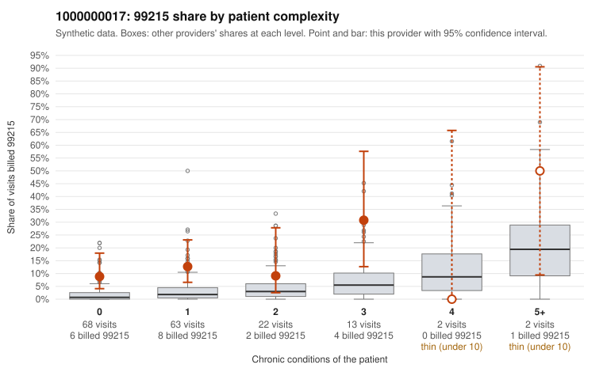

# 1000000017: Elevated 99215 use concentrated on low-complexity patients, but the five documented 99215 notes all support the billed level, so documentation is too thin to call this upcoding.

**Leaning (advisory):** Inconclusive

## Why

1000000017 billed 99215 on 12.4% of 170 claims against an expected 2.3% given patient complexity (risk-adjusted score 4.20; plain z-score vs peers 1.46). 67% of this provider's 99215 claims were on patients with 0 or 1 chronic conditions. Records came back for 30 claims. Of 5 documented 99215 claims, 0 (0%) were documented below the billed level, against 0% for the comparison providers. 1 of 22 notes claiming moderate-or-higher data reviewed had no lab or test line on the claim. The billing pattern raises concern because most 99215 claims fall on patients with zero or one chronic condition. Sampled examples include young patients with nonspecific symptom codes such as abdominal pain (C0009336, C0009356, C0009388, C0009404) and back pain (C0009405), where high-complexity visits would not usually be expected. The documentation, however, does not corroborate upcoding: every documented 99215 (for example C0009352, C0009417, C0009439) records high MDM and roughly 42–43 minutes. Only one note claiming moderate-or-higher data review lacked a lab or test line, so there is little sign of cloned or inflated notes. Five documented 99215 claims are too few to rule anything in or out, and the uniform 42–43 minute times are worth a closer look for templated documentation. A reviewer should first request charts for the undocumented low-complexity 99215 claims, especially the symptom-only R10.9 visits, and check whether the high-MDM notes describe distinct, visit-specific clinical work. Examples: C0009344: billed 99213; documented MDM level straightforward, minutes not recorded. C0009330: billed 99215, patient aged 40 with 1 chronic condition(s) (hyperlipidemia). C0009336: billed 99215, patient aged 61 with 0 chronic condition(s).

## Evidence chart

## Cited claims

`C0009344`, `C0009330`, `C0009336`

## Suggested next steps

- Request records for a larger sample of this provider's 99214 and 99215 claims; what came back is too thin to judge.
- Re-screen the provider once the records arrive.

---
Citations checked: 3/3 valid. Synthetic data. The leaning is advisory; the flag comes from the statistical screen, and no clinical documentation is available beyond the sampled records-review facts shown in the packet.
