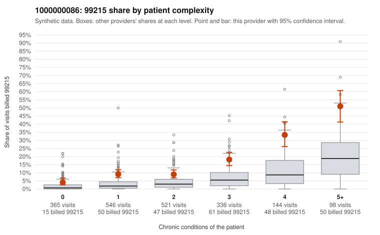

# 1000000086: Provider 1000000086 bills 99215 well above risk-adjusted expectation in every complexity stratum, but the few returned charts support the billed levels and are too thin to settle whether this is upcoding.

**Leaning (advisory):** Inconclusive

## Why

1000000086 billed 99215 on 13.5% of 2,010 claims against an expected 3.8% given patient complexity (risk-adjusted score 10.77; plain z-score vs peers 1.67). 24% of this provider's 99215 claims were on patients with 0 or 1 chronic conditions. Records came back for 30 claims. Of 3 documented 99215 claims, 0 (0%) were documented below the billed level, against 0% for the comparison providers. 3 of 22 notes claiming moderate-or-higher data reviewed had no lab or test line on the claim. The excess is not confined to sick patients: the 99215 share runs above the all-provider rate even for patients with 0 or 1 conditions, and the sampled low-complexity 99215 claims include routine-looking presentations such as upper respiratory infection (C0049062, C0049251), rash (C0049524, C0050226) and follow-up-only visits (C0050139). That pattern is consistent with upcoding, but the heavy 99214 mix and the steep rise in 99215 share with condition count also fit a practice that codes high across a genuinely complex panel. The documentation does not resolve this: only 3 documented 99215 claims came back (C0049632, C0049778, C0049985, all supported at high MDM), records cover a very small share of claims, and the few notes claiming moderate-plus data review without a lab or test line are only weak evidence of inflated notes. A reviewer should first request charts for the sampled low-complexity 99215 claims (for example C0048590, C0049062, C0050139, C0050382) to see whether high MDM is genuinely documented for single-complaint visits. They should also check those notes for cloned or templated language. Examples: C0048590: billed 99215, patient aged 25 with 0 chronic condition(s). C0048671: billed 99215, patient aged 38 with 0 chronic condition(s).

## Evidence chart

## Cited claims

`C0048590`, `C0048671`

## Suggested next steps

- Request records for a larger sample of this provider's 99214 and 99215 claims; what came back is too thin to judge.
- Re-screen the provider once the records arrive.

---
Citations checked: 2/2 valid. Synthetic data. The leaning is advisory; the flag comes from the statistical screen, and no clinical documentation is available beyond the sampled records-review facts shown in the packet.
