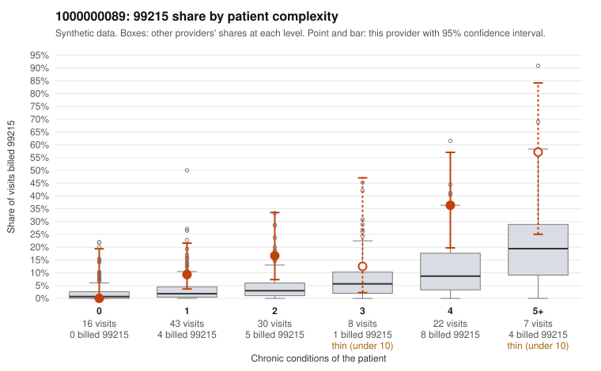

# 1000000089: Provider 1000000089's 99215 rate is well above expectation in every complexity stratum, but the few 99215 charts reviewed all support the billed level, so the evidence points neither way yet.

**Leaning (advisory):** Inconclusive

## Why

1000000089 billed 99215 on 17.5% of 126 claims against an expected 4.3% given patient complexity (risk-adjusted score 3.56; plain z-score vs peers 2.44). 18% of this provider's 99215 claims were on patients with 0 or 1 chronic conditions. Records came back for 30 claims. Of 6 documented 99215 claims, 0 (0%) were documented below the billed level, against 0% for the comparison providers. 2 of 22 notes claiming moderate-or-higher data reviewed had no lab or test line on the claim. The elevated 99215 share is not explained by panel acuity alone: in the by-complexity table this provider bills 99215 at roughly two to three times the all-provider share in each stratum, including 1-condition patients (for example C0051256, C0051259, C0051292). Against that, all 6 documented 99215 claims were supported, including low-complexity C0051344 documented at high MDM with 46 minutes. But 6 charts is too thin to rule out upcoding, and the pattern is consistent with either a legitimately thorough style or inflated notes. Other signals are weak but worth noting: the coding mix is concentrated in 99214 with no 99211 or 99212. Two 99214 claims were documented at low MDM, a rate above peers but on only 20 charts, and 99214 was billed for patients with zero chronic conditions and only a Z09 follow-up code (C0051330, C0051340). The 2 notes claiming moderate-or-higher data reviewed with no lab or test line are only weak evidence that notes may not match the visits. A reviewer should first request more 99215 charts, prioritizing the low-complexity 99215 claims listed, and check whether notes look templated or cloned across visits. They should also review the 99214 claims on 0-condition patients to see whether the documentation supports moderate complexity. Examples: C0051227: billed 99214; documented MDM level low, minutes not recorded. C0051334: billed 99214; documented MDM level low, minutes not recorded. C0051256: billed 99215, patient aged 76 with 1 chronic condition(s) (osteoarthritis). C0051259: billed 99215, patient aged 66 with 1 chronic condition(s) (type 2 diabetes).

## Evidence chart

## Cited claims

`C0051227`, `C0051334`, `C0051256`, `C0051259`

## Suggested next steps

- Request records for a larger sample of this provider's 99214 and 99215 claims; what came back is too thin to judge.
- Re-screen the provider once the records arrive.

---
Citations checked: 4/4 valid. Synthetic data. The leaning is advisory; the flag comes from the statistical screen, and no clinical documentation is available beyond the sampled records-review facts shown in the packet.
