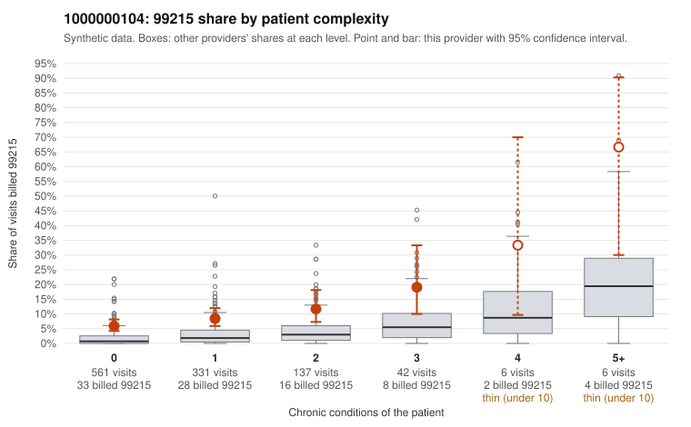

# 1000000104: Provider 1000000104's 99215 excess falls mostly on low-complexity patients, but records are too thin to confirm or rule out upcoding.

**Leaning (advisory):** Inconclusive

## Why

1000000104 billed 99215 on 8.4% of 1,083 claims against an expected 2.0% given patient complexity (risk-adjusted score 7.27; plain z-score vs peers 0.69). 67% of this provider's 99215 claims were on patients with 0 or 1 chronic conditions. Records came back for 30 claims. Of 2 documented 99215 claims, 0 (0%) were documented below the billed level, against 0% for the comparison providers. 2 of 15 notes claiming moderate-or-higher data reviewed had no lab or test line on the claim. The billing pattern does not look like a sicker panel. The 99215 share runs above the all-provider share in every complexity stratum, and most of these claims are on patients with 0 or 1 chronic conditions, such as the Z09 follow-ups (C0056935, C0057147) and the J06.9 upper respiratory visit (C0057394). Those visits are hard to square with high-complexity decision-making. On its own, this is a pattern consistent with upcoding. The documentation, however, neither confirms nor refutes it: only 2 documented 99215 claims came back (C0057306, C0057862), both supported at high MDM, and the 2 no-lab notes claiming moderate-or-higher data reviewed are weak signals at most. A reviewer should first request charts for the sampled low-complexity 99215 claims, starting with the Z09, J06.9, R21 and N39.0 visits, to check whether documented MDM or time supports level 5. Examples: C0056926: billed 99213; documented MDM level straightforward, minutes not recorded. C0056890: billed 99215, patient aged 65 with 0 chronic condition(s). C0056901: billed 99215, patient aged 41 with 0 chronic condition(s).

## Evidence chart

## Cited claims

`C0056926`, `C0056890`, `C0056901`

## Suggested next steps

- Request records for a larger sample of this provider's 99214 and 99215 claims; what came back is too thin to judge.
- Re-screen the provider once the records arrive.

---
Citations checked: 3/3 valid. Synthetic data. The leaning is advisory; the flag comes from the statistical screen, and no clinical documentation is available beyond the sampled records-review facts shown in the packet.
