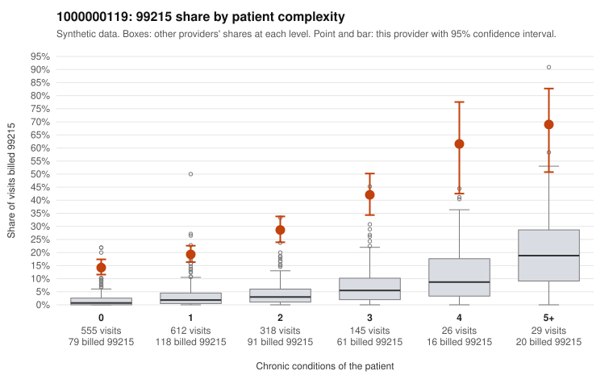

# 1000000119: Provider 1000000119 bills 99215 far above risk-adjusted expectation, with about half of those claims on patients with few or no chronic conditions, but the documentation sample is too thin to confirm or refute upcoding.

**Leaning (advisory):** Inconclusive

## Why

1000000119 billed 99215 on 22.8% of 1,685 claims against an expected 2.6% given patient complexity (risk-adjusted score 24.80; plain z-score vs peers 3.48). 51% of this provider's 99215 claims were on patients with 0 or 1 chronic conditions. Records came back for 30 claims. Of 4 documented 99215 claims, 0 (0%) were documented below the billed level, against 0% for the comparison providers. 1 of 24 notes claiming moderate-or-higher data reviewed had no lab or test line on the claim. The claims pattern leans toward concern. The 99215 share is elevated in every complexity band, not just among sicker patients. Low-complexity 99215 samples such as C0063401, C0064004 and C0064542 (Z09 follow-up, no chronic conditions) and C0063592 and C0064833 (R10.9 abdominal pain alone) are hard to reconcile with high-complexity visits. Against that, all 4 documented 99215 claims were supported at high MDM, including low-complexity claim C0064092 (documented high MDM, 50 minutes), and only 1 of 24 moderate-plus data-reviewed notes lacked a lab or test line. Four charts are too few to judge, and the notes could be templated to match the billed level. A reviewer should first request records for a targeted sample of low-complexity 99215 claims, such as the Z09 and single-symptom visits listed. Those charts should be checked for MDM consistent with the presenting problem, cloned note language, and time documentation. Examples: C0063729: billed 99214; documented MDM level low, minutes not recorded. C0063076: billed 99215, patient aged 44 with 0 chronic condition(s). C0063097: billed 99215, patient aged 49 with 1 chronic condition(s) (asthma).

## Evidence chart

## Cited claims

`C0063729`, `C0063076`, `C0063097`

## Suggested next steps

- Request records for a larger sample of this provider's 99214 and 99215 claims; what came back is too thin to judge.
- Re-screen the provider once the records arrive.

---
Citations checked: 3/3 valid. Synthetic data. The leaning is advisory; the flag comes from the statistical screen, and no clinical documentation is available beyond the sampled records-review facts shown in the packet.
