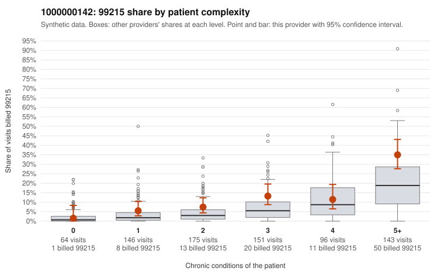

# 1000000142: 1000000142: documented 99215 claims mostly support the level billed (0% below)

**Leaning (advisory):** Pattern consistent with a high-acuity panel

## Why

1000000142 billed 99215 on 13.3% of 775 claims against an expected 6.3% given patient complexity (risk-adjusted score 3.91; plain z-score vs peers 1.64). 9% of this provider's 99215 claims were on patients with 0 or 1 chronic conditions. Records came back for 30 claims. Of 6 documented 99215 claims, 0 (0%) were documented below the billed level, against 0% for the comparison providers. 3 of 17 notes claiming moderate-or-higher data reviewed had no lab or test line on the claim. This pattern is consistent with a high-acuity panel. The sampled documentation supports the billed level. Examples: C0075171: billed 99215; documented MDM level high, 47 minutes. C0075414: billed 99215; documented MDM level high, minutes not recorded. C0075559: billed 99215; documented MDM level high, minutes not recorded. C0075155: billed 99215, patient aged 60 with 5 chronic condition(s) (type 2 diabetes;hyperlipidemia;depression;heart failure;chronic kidney disease). C0075332: billed 99215, patient aged 63 with 4 chronic condition(s) (type 2 diabetes;obesity;hypertension;chronic kidney disease).

## Evidence chart

## Cited claims

`C0075171`, `C0075414`, `C0075559`, `C0075155`, `C0075332`

## Suggested next steps

- Do not pursue recovery on this evidence: the documentation returned supports the level billed.
- Revisit if the provider's 99215 share keeps rising against peers, or if a larger records sample shows unsupported claims.

---
Citations checked: 5/5 valid. Synthetic data. The leaning is advisory; the flag comes from the statistical screen, and no clinical documentation is available beyond the sampled records-review facts shown in the packet.
