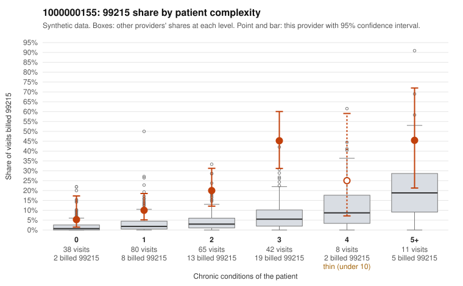

# 1000000155: Provider 1000000155 bills 99215 well above risk-adjusted expectation in every complexity band, but the few retrieved charts support the billed level, so the pattern is unresolved.

**Leaning (advisory):** Inconclusive

## Why

1000000155 billed 99215 on 20.1% of 244 claims against an expected 3.6% given patient complexity (risk-adjusted score 6.66; plain z-score vs peers 2.95). 20% of this provider's 99215 claims were on patients with 0 or 1 chronic conditions. Records came back for 30 claims. Of 7 documented 99215 claims, 0 (0%) were documented below the billed level, against 0% for the comparison providers. 9 of 21 notes claiming moderate-or-higher data reviewed had no lab or test line on the claim. The 99215 excess is not confined to sicker patients: the provider's share runs roughly two to five times the all-provider rate in every condition band, including 0–1 condition visits (for example C0080528 and C0080531 for hypertension alone, and three CKD-only visits for patient M0033991). That is more consistent with a billing habit than with panel acuity alone. Against this, all 7 documented 99215 claims were supported, including low-complexity C0080733, which documents high MDM and 49 minutes. Seven charts is too thin to clear the provider, and the 9 of 21 moderate-plus data-reviewed notes with no lab or test line on the claim are weak evidence that the notes may be templated or inflated rather than reflecting what happened. A reviewer should first pull full charts for the low-complexity 99215 sample, especially the repeat M0033991 visits, and compare note text across visits for cloned language. They should also check whether the data-reviewed claims correspond to any orders or results outside these claims. Examples: C0080528: billed 99215, patient aged 58 with 1 chronic condition(s) (hypertension). C0080531: billed 99215, patient aged 55 with 1 chronic condition(s) (hypertension).

## Evidence chart

## Cited claims

`C0080528`, `C0080531`

## Suggested next steps

- Request records for a larger sample of this provider's 99214 and 99215 claims; what came back is too thin to judge.
- Re-screen the provider once the records arrive.

---
Citations checked: 2/2 valid. Synthetic data. The leaning is advisory; the flag comes from the statistical screen, and no clinical documentation is available beyond the sampled records-review facts shown in the packet.
