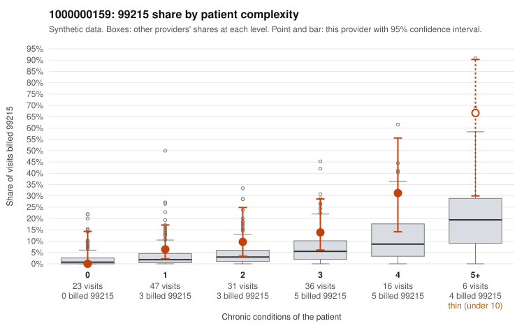

# 1000000159: Elevated 99215 use is concentrated in multi-morbid patients and the few documented 99215s are supported, but documentation is too thin to rule out upcoding.

**Leaning (advisory):** Inconclusive

## Why

1000000159 billed 99215 on 12.6% of 159 claims against an expected 4.0% given patient complexity (risk-adjusted score 2.72; plain z-score vs peers 1.50). 15% of this provider's 99215 claims were on patients with 0 or 1 chronic conditions. Records came back for 30 claims. Of 5 documented 99215 claims, 0 (0%) were documented below the billed level, against 0% for the comparison providers. 1 of 14 notes claiming moderate-or-higher data reviewed had no lab or test line on the claim. The 99215 share rises steeply with condition count and most sampled 99215s are on patients with four or five chronic conditions (e.g., C0081510, C0081581), which fits a sicker panel. However, the provider's 99215 rate exceeds the all-provider rate in every complexity band, so complexity alone may not explain the excess. Documented 99215 claims (C0081554, C0081626, C0081629, C0081607) show high MDM with 41-48 minutes where recorded, but five charts are too few to judge, and the single moderate-plus data-reviewed note with no lab line is weak evidence. The low-complexity 99215s are the reviewer's first priority, especially C0081488 (26-year-old, hypertension with nonspecific abdominal pain) and C0081604 (18-year-old, osteoarthritis only); obtaining their charts and more 99215 records would most quickly resolve whether the excess reflects upcoding. Also note that repeat 99215s on the same patients (M0034376, M0034344) should be checked for cloned notes. Examples: C0081557: billed 99213; documented MDM level straightforward, minutes not recorded. C0081656: billed 99214; documented MDM level low, 22 minutes. C0081488: billed 99215, patient aged 26 with 1 chronic condition(s) (hypertension). C0081591: billed 99215, patient aged 40 with 1 chronic condition(s) (depression).

## Evidence chart

## Cited claims

`C0081557`, `C0081656`, `C0081488`, `C0081591`

## Suggested next steps

- Request records for a larger sample of this provider's 99214 and 99215 claims; what came back is too thin to judge.
- Re-screen the provider once the records arrive.

---
Citations checked: 4/4 valid. Synthetic data. The leaning is advisory; the flag comes from the statistical screen, and no clinical documentation is available beyond the sampled records-review facts shown in the packet.
