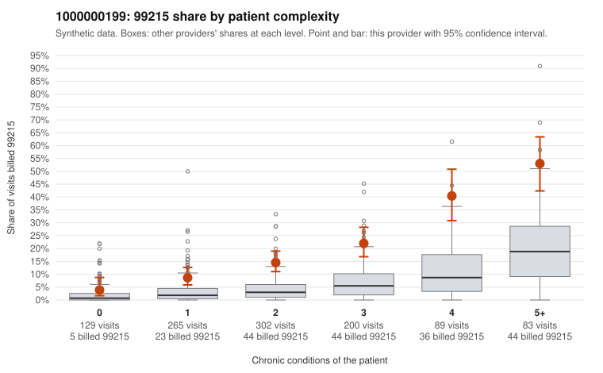

# 1000000199: Provider 1000000199 bills 99215 well above expectation in every complexity group, but the few charts reviewed support the billed levels, so the pattern is unresolved.

**Leaning (advisory):** Inconclusive

## Why

1000000199 billed 99215 on 18.4% of 1,068 claims against an expected 4.5% given patient complexity (risk-adjusted score 10.50; plain z-score vs peers 2.61). 14% of this provider's 99215 claims were on patients with 0 or 1 chronic conditions. Records came back for 30 claims. Of 8 documented 99215 claims, 0 (0%) were documented below the billed level, against 0% for the comparison providers. 1 of 16 notes claiming moderate-or-higher data reviewed had no lab or test line on the claim. The 99215 excess is not confined to sicker patients: the by-complexity table shows this provider's 99215 share running about two to three times the all-provider share in every condition-count group, from single-condition visits up to 4+ conditions. That points to higher coding intensity than patient complexity alone explains. The sampled low-complexity 99215 claims include routine-looking presentations, such as C0097652 (upper respiratory infection, no chronic conditions), C0097638 (urinary tract infection, no chronic conditions) and C0098352 (back pain, age 18). The sampled high-complexity claims, such as C0098277 and C0098591, look clinically plausible for the top level. Against this, all 8 documented 99215 claims supported the billed level, and only 1 data-review note lacked a lab or test line, which is weak evidence at most. However, records cover under 3% of claims, so the documentation is too thin to clear or confirm the pattern, and two supported examples (C0097960, C0098104) have no recorded minutes. A reviewer should first request charts for the low-complexity 99215 claims listed above and check the supported notes for cloned or templated medical decision making. Examples: C0097622: billed 99215, patient aged 66 with 1 chronic condition(s) (hypertension). C0097638: billed 99215, patient aged 33 with 0 chronic condition(s).

## Evidence chart

## Cited claims

`C0097622`, `C0097638`

## Suggested next steps

- Request records for a larger sample of this provider's 99214 and 99215 claims; what came back is too thin to judge.
- Re-screen the provider once the records arrive.

---
Citations checked: 2/2 valid. Synthetic data. The leaning is advisory; the flag comes from the statistical screen, and no clinical documentation is available beyond the sampled records-review facts shown in the packet.
