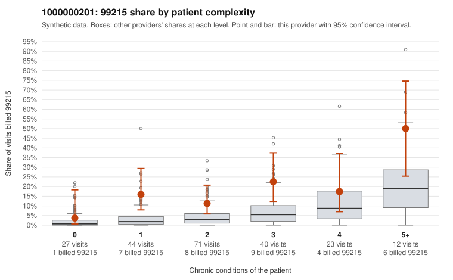

# 1000000201: Provider 1000000201 bills 99215 well above its risk-adjusted expectation at every complexity tier, but the few returned charts support the billed levels, so the pattern cannot yet be called upcoding or a legitimately complex panel.

**Leaning (advisory):** Inconclusive

## Why

1000000201 billed 99215 on 16.1% of 217 claims against an expected 4.3% given patient complexity (risk-adjusted score 4.17; plain z-score vs peers 2.18). 23% of this provider's 99215 claims were on patients with 0 or 1 chronic conditions. Records came back for 24 claims. Of 5 documented 99215 claims, 0 (0%) were documented below the billed level, against 0% for the comparison providers. 0 of 22 notes claiming moderate-or-higher data reviewed had no lab or test line on the claim. The excess 99215 billing is not explained by panel mix. The provider's 99215 share exceeds the all-provider rate in every condition-count band, and it is most pronounced among patients with one chronic condition. Sampled examples such as C0099067 (age 18, type 2 diabetes only) and C0099148 (no chronic conditions, urinary tract infection code) are the kind of low-complexity 99215 visits that warrant scrutiny. On the other side, none of the returned documented claims at any level fell below the billed level. The 99215 notes, including low-complexity claim C0099099, recorded high MDM. Every note claiming moderate-or-higher data review had a matching lab or test line, so there is no sign of cloned documentation. With only 5 documented 99215 claims, the documentation is too thin to confirm or rule out upcoding. A reviewer should first request charts for the low-complexity 99215 claims, starting with C0099067, C0099148, C0099102 and C0099162. The reviewer should then check whether those notes show genuinely high-complexity decision-making rather than templated text. Examples: C0099060: billed 99215, patient aged 54 with 1 chronic condition(s) (obesity). C0099067: billed 99215, patient aged 18 with 1 chronic condition(s) (type 2 diabetes).

## Evidence chart

## Cited claims

`C0099060`, `C0099067`

## Suggested next steps

- Request records for a larger sample of this provider's 99214 and 99215 claims; what came back is too thin to judge.
- Re-screen the provider once the records arrive.

---
Citations checked: 2/2 valid. Synthetic data. The leaning is advisory; the flag comes from the statistical screen, and no clinical documentation is available beyond the sampled records-review facts shown in the packet.
