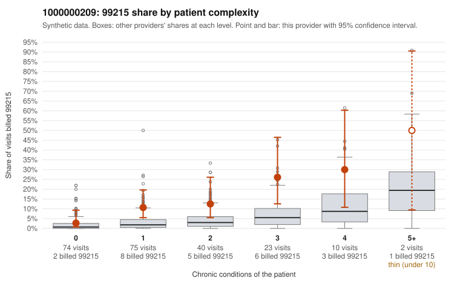

# 1000000209: Elevated 99215 rate concentrated partly on 1-condition patients, but the few charted 99215s support the billed level, so documentation is too thin to settle the question.

**Leaning (advisory):** Inconclusive

## Why

1000000209 billed 99215 on 11.2% of 224 claims against an expected 2.7% given patient complexity (risk-adjusted score 3.82; plain z-score vs peers 1.23). 40% of this provider's 99215 claims were on patients with 0 or 1 chronic conditions. Records came back for 30 claims. Of 4 documented 99215 claims, 0 (0%) were documented below the billed level, against 0% for the comparison providers. 3 of 22 notes claiming moderate-or-higher data reviewed had no lab or test line on the claim. The excess 99215 billing is not explained by panel complexity alone. The 0-condition stratum matches peers, but 1-condition visits draw 99215 at more than twice the all-provider share, and the sampled low-complexity 99215s (e.g., C0103277, C0103282, C0103288 for hyperlipidemia alone) fit the concern pattern. Higher-complexity strata are also above peer rates, though, and the four documented 99215s (C0103256, C0103374, C0103383, C0103420) all record high MDM. Four charts are too few to judge, and the sample may not include the low-complexity claims at issue. The mild excess of below-billed documentation at 99213 and 99214 (e.g., C0103311, C0103401 documented as low MDM) and the 3 data-reviewed notes with no lab or test line are weak signals, not proof of inflated or cloned notes. A reviewer should first request charts for the sampled 1-condition 99215 claims (e.g., C0103277, C0103418, C0103433) to see whether the documented MDM supports a high level for a single stable condition. Examples: C0103311: billed 99214; documented MDM level low, minutes not recorded. C0103401: billed 99214; documented MDM level low, minutes not recorded. C0103274: billed 99215, patient aged 28 with 0 chronic condition(s). C0103277: billed 99215, patient aged 51 with 1 chronic condition(s) (hyperlipidemia).

## Evidence chart

## Cited claims

`C0103311`, `C0103401`, `C0103274`, `C0103277`

## Suggested next steps

- Request records for a larger sample of this provider's 99214 and 99215 claims; what came back is too thin to judge.
- Re-screen the provider once the records arrive.

---
Citations checked: 4/4 valid. Synthetic data. The leaning is advisory; the flag comes from the statistical screen, and no clinical documentation is available beyond the sampled records-review facts shown in the packet.
