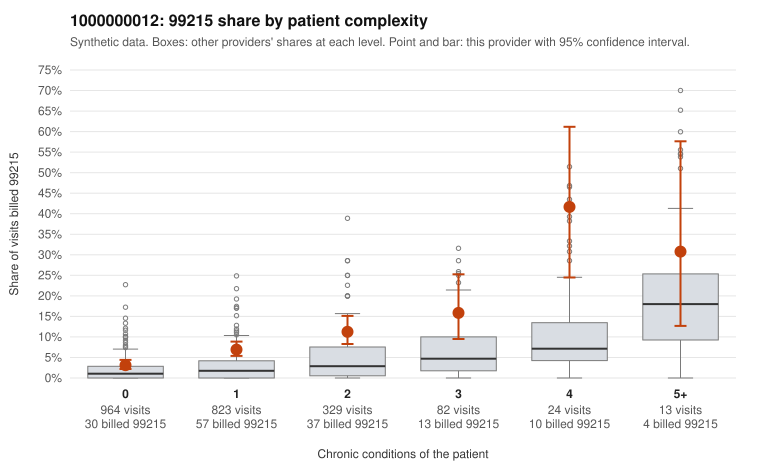

# 1000000012: Provider 1000000012 bills 99215 well above its risk-adjusted expectation, mostly on low-complexity patients, but the documentation sample is too thin to confirm or refute upcoding.

**Leaning (advisory):** Inconclusive

## Why

1000000012 billed 99215 on 6.8% of 2,235 claims against an expected 2.0% given patient complexity (risk-adjusted score 5.86; plain z-score vs peers 0.34). 58% of this provider's 99215 claims were on patients with 0 or 1 chronic conditions. Records came back for 21 claims. Of 3 documented 99215 claims, 0 (0%) were documented below the billed level, against 14% for the comparison providers. 2 of 11 notes claiming moderate-or-higher data reviewed had no lab or test line on the claim. The excess 99215 billing is not explained by panel complexity: the majority of 99215 claims fall on patients with 0 or 1 chronic conditions, and the share is roughly double the all-provider rate in every complexity band, including the 0-condition stratum. Sampled low-complexity claims such as C0005313, C0005755 and C0006396 carry only simple diagnoses like N39.0 or Z09, which is a pattern consistent with upcoding. Against that, the 3 documented 99215 claims (C0005170, C0005648, C0006585) all showed high MDM, and none of the 21 returned charts were documented below the billed level. That is far too few records to judge, and 2 notes claimed moderate-or-higher data review with no lab or test line on the claim, a weak signal that some notes may be templated. A reviewer should first request charts specifically for the low-complexity 99215 claims listed in the packet and check whether the documented MDM and time actually reflect the encounter, including whether note text is cloned across visits. Examples: C0005313: billed 99215, patient aged 42 with 0 chronic condition(s). C0005415: billed 99215, patient aged 48 with 1 chronic condition(s) (hypertension).

## Evidence chart

## Cited claims

`C0005313`, `C0005415`

## Suggested next steps

- Request records for a larger sample of this provider's 99214 and 99215 claims; what came back is too thin to judge.
- Re-screen the provider once the records arrive.

---
Citations checked: 2/2 valid. Synthetic data. The leaning is advisory; the flag comes from the statistical screen, and no clinical documentation is available beyond the sampled records-review facts shown in the packet.
