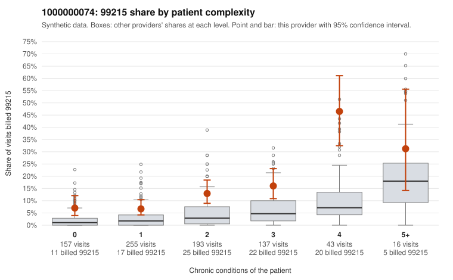

# 1000000074: Provider 1000000074 bills 99215 well above risk-adjusted expectation in every complexity stratum, but records cover too few high-level claims to confirm or rule out upcoding.

**Leaning (advisory):** Inconclusive

## Why

1000000074 billed 99215 on 12.5% of 801 claims against an expected 3.0% given patient complexity (risk-adjusted score 5.77; plain z-score vs peers 1.37). 28% of this provider's 99215 claims were on patients with 0 or 1 chronic conditions. Records came back for 21 claims. Of 2 documented 99215 claims, 0 (0%) were documented below the billed level, against 14% for the comparison providers. 4 of 15 notes claiming moderate-or-higher data reviewed had no lab or test line on the claim. The elevated 99215 share holds across all complexity bands, not just among sicker patients. Low-complexity 99215s in the sample include visits with only acute or nonspecific diagnoses, such as UTI (C0038728, C0038754), URI (C0038762, C0039354) and follow-up Z09 (C0039322, C0039340). That pattern is consistent with upcoding, though the sample cannot be generalized. The provider also has a heavier tail of 4+ condition patients, and the only two documented 99215s (C0038911, C0039025) were high-complexity patients with high MDM supporting the billed level. So part of the excess may reflect genuine acuity. Documentation is too thin to judge because so few 99214/99215 charts came back. The few notes claiming moderate-or-higher data reviewed with no lab or test line on the claim are weak evidence of templated notes, not proof. A reviewer should first request charts for the sampled low-complexity 99215 claims, especially the Z09 and acute-only visits, to see whether the documented MDM supports level 5. Examples: C0038990: billed 99213; documented MDM level straightforward, 17 minutes. C0038720: billed 99215, patient aged 38 with 1 chronic condition(s) (hypertension). C0038728: billed 99215, patient aged 54 with 0 chronic condition(s).

## Evidence chart

## Cited claims

`C0038990`, `C0038720`, `C0038728`

## Suggested next steps

- Request records for a larger sample of this provider's 99214 and 99215 claims; what came back is too thin to judge.
- Re-screen the provider once the records arrive.

---
Citations checked: 3/3 valid. Synthetic data. The leaning is advisory; the flag comes from the statistical screen, and no clinical documentation is available beyond the sampled records-review facts shown in the packet.
