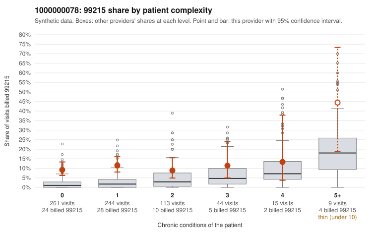

# 1000000078: Provider 1000000078 bills 99215 well above its risk-adjusted expectation, mostly on patients with few or no chronic conditions, but documentation is too thin to confirm whether the level is supported.

**Leaning (advisory):** Inconclusive

## Why

1000000078 billed 99215 on 10.6% of 686 claims against an expected 2.3% given patient complexity (risk-adjusted score 5.40; plain z-score vs peers 1.04). 71% of this provider's 99215 claims were on patients with 0 or 1 chronic conditions. Records came back for 14 claims. Of 3 documented 99215 claims, 2 (67%) were documented below the billed level, against 14% for the comparison providers. 1 of 8 notes claiming moderate-or-higher data reviewed had no lab or test line on the claim. The billing pattern is consistent with upcoding: the 99215 share exceeds the all-provider share in every complexity band, and the excess is concentrated in the 0- and 1-condition groups. Sampled low-complexity 99215 claims carry simple diagnoses such as low back pain (M54.50), UTI (N39.0), rash (R21) or follow-up (Z09), for example C0040981... specifically C0039981, C0040007, C0040206 and C0040180. A few sampled high-complexity 99215 claims (e.g., C0040074, C0040251) look clinically plausible, and C0040074 was documented as high MDM. Records returned for only a handful of claims. Two of the three documented 99215s were below the billed level, including C0040445 and C0040499 at moderate MDM with about 30 minutes. That is directionally concerning, but the sample is far too small to lean either way, and the single data-reviewed mismatch is weak evidence at most. A reviewer should first request additional charts focused on the low-complexity 99215 claims listed in the packet, to see whether documented MDM or time supports the billed level. Examples: C0040445: billed 99215, patient aged 53 with 1 chronic condition(s) (COPD); documented MDM level moderate, 31 minutes. C0040499: billed 99215; documented MDM level moderate, 30 minutes. C0039981: billed 99215, patient aged 27 with 0 chronic condition(s). C0040007: billed 99215, patient aged 55 with 0 chronic condition(s).

## Evidence chart

## Cited claims

`C0040445`, `C0040499`, `C0039981`, `C0040007`

## Suggested next steps

- Request records for a larger sample of this provider's 99214 and 99215 claims; what came back is too thin to judge.
- Re-screen the provider once the records arrive.

---
Citations checked: 4/4 valid. Synthetic data. The leaning is advisory; the flag comes from the statistical screen, and no clinical documentation is available beyond the sampled records-review facts shown in the packet.
