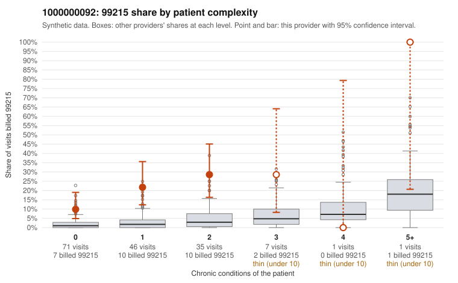

# 1000000092: Provider 1000000092 bills 99215 far above what its largely low-complexity panel predicts, but only two 99215 charts came back, so documentation cannot yet confirm or refute upcoding.

**Leaning (advisory):** Inconclusive

## Why

1000000092 billed 99215 on 18.6% of 161 claims against an expected 2.1% given patient complexity (risk-adjusted score 5.40; plain z-score vs peers 2.48). 57% of this provider's 99215 claims were on patients with 0 or 1 chronic conditions. Records came back for 19 claims. Of 2 documented 99215 claims, 0 (0%) were documented below the billed level, against 14% for the comparison providers. 0 of 15 notes claiming moderate-or-higher data reviewed had no lab or test line on the claim. The billing pattern raises concern because the excess 99215 use sits mostly on patients with zero or one chronic condition, often for routine problems such as upper respiratory infection (C0048722), urinary tract infection (C0048652, C0048721) or rash (C0048619). The provider's 99215 share is above the all-provider rate in every complexity band, and 99214 also dominates the mix, including on zero-condition visits (C0048717, C0048726). That is the pattern one would expect from upcoding rather than from a sicker panel. Against this, the two documented 99215 claims, C0048616 and C0048739, both show high MDM and adequate minutes, and the 99214 mismatch rate is close to the all-provider rate. Two charts are far too few to judge, so the leaning stays inconclusive. A reviewer should first request records for the sampled low-complexity 99215 claims, especially the acute single-problem visits. The check is whether high MDM is genuinely supported or whether the notes look templated. Examples: C0048706: billed 99214; documented MDM level low, minutes not recorded. C0048610: billed 99215, patient aged 54 with 1 chronic condition(s) (hypothyroidism). C0048616: billed 99215, patient aged 44 with 1 chronic condition(s) (hypertension); documented MDM level high, 46 minutes.

## Evidence chart

## Cited claims

`C0048706`, `C0048610`, `C0048616`

## Suggested next steps

- Request records for a larger sample of this provider's 99214 and 99215 claims; what came back is too thin to judge.
- Re-screen the provider once the records arrive.

---
Citations checked: 3/3 valid. Synthetic data. The leaning is advisory; the flag comes from the statistical screen, and no clinical documentation is available beyond the sampled records-review facts shown in the packet.
